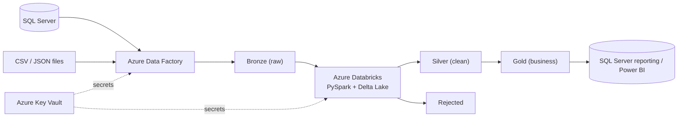

# Banking Data Engineering on Azure

**An end-to-end, hands-on banking data platform built with Azure Data Factory, ADLS Gen2, Azure Databricks (PySpark, Spark SQL, Delta Lake), SQL Server and Azure Key Vault, using the Medallion (Bronze → Silver → Gold) architecture.**


> 🚧 **Work in progress.** This repository is built module by module as a learning project. The progress tracker below shows what is complete.

## What this project does

A fictional bank, **FinTrust Bank**, receives customer, account, transaction, loan, credit card and payment data from a SQL Server database and from daily CSV and JSON files. The data contains duplicates, invalid values and orphan keys. This project builds an automated platform that:

1. **Ingests** all sources into Azure Data Lake Storage with Azure Data Factory (full, incremental and metadata-driven loads).
2. **Cleans and validates** the data in Azure Databricks with PySpark, sending bad rows to a `rejected` area with the reason.
3. **Publishes** business-ready Gold tables (customer 360, daily and monthly transactions, branch performance, loans, credit cards).
4. **Serves** the Gold data back to SQL Server for reporting.



The full architecture is described in [Module 1](docs/01-project-overview.md#4-architecture).

## Learning modules

| # | Module | Status |
|---|---|---|
| 1 | [Project introduction, architecture, prerequisites](docs/01-project-overview.md) | ✅ Done |
| 2 | [Azure Resource Group](docs/02-azure-resource-group.md) · [Step-by-step lab](docs/02-lab-azure-resource-group.md) | ✅ Done |
| 3 | [Storage Account and ADLS Gen2](docs/03-storage-adls-gen2.md) · [Step-by-step lab](docs/03-lab-storage-adls-gen2.md) | ✅ Done |
| 4 | [SQL Server fundamentals and BankingDB](docs/04-sql-server-bankingdb.md) · [Step-by-step lab](docs/04-lab-sql-server-bankingdb.md) | ✅ Done |
| 5 | [Azure Data Factory setup](docs/05-azure-data-factory-setup.md) · [Step-by-step lab](docs/05-lab-azure-data-factory-setup.md) | ✅ Available |
| 6 | ADF activities | ⬜ Next |
| 7 | ADF pipelines | ⬜ |
| 8 | Azure Databricks setup | ⬜ |
| 9 | PySpark fundamentals | ⬜ |
| 10 | Bronze layer | ⬜ |
| 11 | Silver layer and data quality | ⬜ |
| 12 | Gold layer | ⬜ |
| 13 | Incremental loading | ⬜ |
| 14 | Logging, auditing and error handling | ⬜ |
| 15 | End-to-end testing | ⬜ |
| 16 | GitHub publishing and interview preparation | ⬜ |

Each module follows the same format: **What is it → Why → Real-world example → Azure portal steps → Implementation → Explanation → Expected output → Common errors → Assignment → Interview questions.**

## Repository structure (current)

```text
banking-data-engineering/
├── README.md
├── LICENSE
├── .gitignore
├── datasets/                         Fictional sample data (with planted data quality problems)
│   ├── README.md                     Data dictionary
│   ├── branches.csv                  16 rows
│   ├── customers.csv                 303 rows
│   ├── accounts.csv                  451 rows
│   ├── transactions.csv              3,006 rows
│   ├── loans.csv                     121 rows
│   ├── credit_card_transactions.csv  1,503 rows
│   └── payments.json                 601 records (JSON Lines)
├── docs/
│   ├── 01-project-overview.md        Module 1
│   ├── 02-azure-resource-group.md    Module 2 (theory)
│   ├── 02-lab-azure-resource-group.md  Module 2 (step-by-step lab with pictures)
│   ├── 03-storage-adls-gen2.md       Module 3 (theory)
│   ├── 03-lab-storage-adls-gen2.md   Module 3 (step-by-step lab with pictures)
│   ├── 04-sql-server-bankingdb.md    Module 4 (theory)
│   ├── 04-lab-sql-server-bankingdb.md  Module 4 (step-by-step lab with pictures)
│   ├── 05-azure-data-factory-setup.md  Module 5 (theory)
│   ├── 05-lab-azure-data-factory-setup.md  Module 5 (step-by-step lab with pictures)
│   └── images/                       Lab pictures (module-02/ to module-05/)
├── sql-server/                       Module 4: BankingDB scripts, run in order 01 → 06
│   ├── 01_create_database.sql
│   ├── 02_create_tables.sql
│   ├── 03_load_data.sql
│   ├── 04_data_profiling.sql
│   ├── 05_sql_practice.sql
│   ├── 06_views_and_procedures.sql
│   └── 07_adf_reader_permissions.sql  Module 5: read-only login for ADF
└── scripts/
    ├── generate_datasets.py          Reproducible data generator (seeded)
    └── azure/
        ├── 01_resource_group.sh      Module 2: resource group, tags, providers (Azure CLI)
        ├── 02_storage_account.sh     Module 3: ADLS Gen2 account, folders, upload (Azure CLI)
        └── 03_data_factory.sh        Module 5: Data Factory, Key Vault, role assignments (Azure CLI)
```

The `adf/` folder is written by Azure Data Factory itself through Git integration (Module 5). Folders for `databricks/`, `architecture/` and `exercises/` are added as each module is completed.

## Data and security

- All data is **fictional**. No real customer or banking information is used.
- No passwords, keys or connection strings are stored in this repository. Secrets are kept in Azure Key Vault (from Module 5) and read by managed identities. `.gitignore` blocks common secret files.

## License

[MIT](LICENSE)
