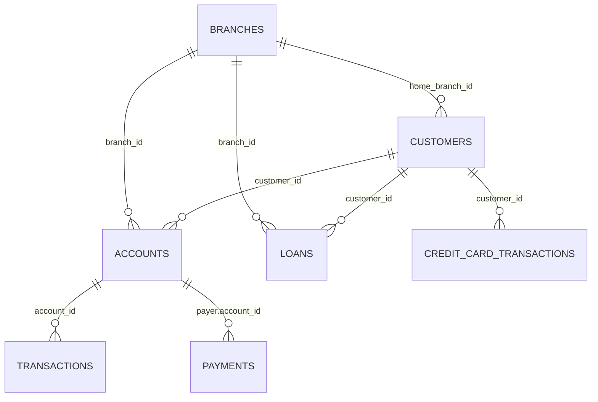

# Sample Banking Datasets: Data Dictionary

All data is **fictional** and was generated by [`scripts/generate_datasets.py`](../scripts/generate_datasets.py) with a fixed random seed, so running it again gives the same files. Names, emails (`@example.com`), phone numbers and IFSC codes (`FAKE0...`) are fake.

**Period covered:** 1 January to 31 March 2026. **Currency:** INR.



> Each file intentionally contains **data quality problems** (duplicates, nulls, invalid values, orphan keys). Do **not** fix the files by hand. Fixing them with code is the purpose of the Silver layer (Module 11).

---

## branches.csv (16 rows) · source: SQL Server

| Column | Type | Description |
|---|---|---|
| `branch_id` | VARCHAR(10), **PK** | Branch code, `BR001`–`BR015` |
| `branch_name` | VARCHAR(100) | Branch name |
| `city` | VARCHAR(50) | City |
| `state` | VARCHAR(50) | State |
| `ifsc_code` | VARCHAR(11) | Fake IFSC code |
| `opened_date` | DATE (`yyyy-MM-dd`) | Date the branch opened |
| `manager_name` | VARCHAR(100) | Branch manager |

## customers.csv (303 rows) · source: SQL Server

| Column | Type | Description |
|---|---|---|
| `customer_id` | VARCHAR(10), **PK** | `C00001`–`C00300` |
| `first_name`, `last_name` | VARCHAR(50) | Name |
| `date_of_birth` | DATE | Expected format `yyyy-MM-dd` |
| `gender` | CHAR(1) | `M` or `F` |
| `email` | VARCHAR(100) | Email address |
| `phone` | VARCHAR(20) | `+91-9xxxxxxxxx` |
| `city`, `state` | VARCHAR(50) | Address |
| `customer_segment` | VARCHAR(20) | `RETAIL`, `PREMIUM`, `CORPORATE` |
| `kyc_status` | VARCHAR(20) | `VERIFIED`, `PENDING`, `REJECTED` |
| `home_branch_id` | VARCHAR(10), **FK** → branches | Home branch |
| `created_date` | DATE | Customer since |

## accounts.csv (451 rows) · source: daily CSV file

| Column | Type | Description |
|---|---|---|
| `account_id` | VARCHAR(10), **PK** | `A000001`–`A000450` |
| `customer_id` | **FK** → customers | Account owner |
| `branch_id` | **FK** → branches | Branch that holds the account |
| `account_type` | VARCHAR(20) | `SAVINGS`, `CURRENT`, `SALARY`, `FIXED_DEPOSIT` |
| `currency` | CHAR(3) | Expected `INR` |
| `open_date` | DATE | Account open date |
| `status` | VARCHAR(10) | `ACTIVE`, `DORMANT`, `CLOSED` |
| `current_balance` | DECIMAL(18,2) | Balance, must be ≥ 0 |
| `interest_rate` | DECIMAL(5,2) | Annual interest % |

## transactions.csv (3,006 rows) · source: daily CSV file

| Column | Type | Description |
|---|---|---|
| `transaction_id` | VARCHAR(12), **PK** | `T0000001`–`T0003000` |
| `account_id` | **FK** → accounts | Account debited or credited |
| `transaction_ts` | TIMESTAMP | Expected format `yyyy-MM-dd HH:mm:ss` |
| `transaction_type` | VARCHAR(20) | `DEPOSIT`, `WITHDRAWAL`, `TRANSFER_OUT`, `TRANSFER_IN` |
| `amount` | DECIMAL(18,2) | Must be > 0 |
| `currency` | CHAR(3) | `INR` |
| `channel` | VARCHAR(20) | `ATM`, `UPI`, `NEFT`, `IMPS`, `BRANCH`, `NETBANKING`, `POS` |
| `counterparty_account` | VARCHAR(10) | Other account for transfers, otherwise empty |
| `status` | VARCHAR(10) | `SUCCESS`, `FAILED`, `REVERSED` |
| `description` | VARCHAR(200) | Free text |

## loans.csv (121 rows) · source: daily CSV file

| Column | Type | Description |
|---|---|---|
| `loan_id` | VARCHAR(10), **PK** | `L00001`–`L00120` |
| `customer_id` | **FK** → customers | Borrower |
| `branch_id` | **FK** → branches | Lending branch |
| `loan_type` | VARCHAR(20) | `HOME`, `PERSONAL`, `AUTO`, `EDUCATION`, `BUSINESS` |
| `principal_amount` | DECIMAL(18,2) | Loan amount, must be > 0 |
| `interest_rate` | DECIMAL(5,2) | Annual % |
| `tenure_months` | INT | Loan term |
| `start_date` | DATE | Disbursement date |
| `emi_amount` | DECIMAL(18,2) | Monthly instalment |
| `outstanding_amount` | DECIMAL(18,2) | Still to be repaid, must be ≤ principal |
| `loan_status` | VARCHAR(15) | `ACTIVE`, `CLOSED`, `DEFAULTED`, `NPA` |
| `days_past_due` | INT | Days the EMI is overdue (0 = on time) |

## credit_card_transactions.csv (1,503 rows) · source: daily CSV file

| Column | Type | Description |
|---|---|---|
| `cc_txn_id` | VARCHAR(12), **PK** | `CC0000001`–`CC0001500` |
| `card_id` | VARCHAR(12) | Card used |
| `customer_id` | **FK** → customers | Card holder |
| `txn_ts` | TIMESTAMP | Transaction time |
| `merchant_name` | VARCHAR(100) | Merchant |
| `merchant_category` | VARCHAR(30) | `SHOPPING`, `FOOD`, `GROCERY`, `FUEL`, `TRAVEL`, `HEALTH`, `ENTERTAINMENT`, `ELECTRONICS` |
| `amount` | DECIMAL(18,2) | Must be > 0 |
| `currency` | CHAR(3) | `INR` |
| `city` | VARCHAR(50) | Where the card was used |
| `status` | VARCHAR(10) | `APPROVED`, `DECLINED` |
| `is_international` | CHAR(1) | `Y` or `N` |

## payments.json (601 records) · source: payments API export (JSON Lines)

One JSON object per line. Nested structure:

```json
{
  "payment_id": "P000001",
  "payment_type": "BILL_PAYMENT",
  "payment_ts": "2026-01-16T01:22:00Z",
  "payer":  { "customer_id": "C00088", "account_id": "A000370" },
  "payee":  { "reference": "Airtel Postpaid", "category": "BILL_PAYMENT" },
  "amount": { "value": 44535.42, "currency": "INR" },
  "mode": "AUTO_DEBIT",
  "status": "SUCCESS"
}
```

| Field | Type | Description |
|---|---|---|
| `payment_id` | STRING, **PK** | `P000001`–`P000600` |
| `payment_type` | STRING | `BILL_PAYMENT`, `LOAN_EMI`, `CREDIT_CARD_BILL` |
| `payment_ts` | TIMESTAMP (ISO 8601, UTC) | Payment time |
| `payer.customer_id` / `payer.account_id` | STRING, **FK** | Who paid, from which account |
| `payee.reference` | STRING | Biller name, loan ID or card ID |
| `amount.value` / `amount.currency` | DECIMAL / STRING | Amount, must be > 0 |
| `mode` | STRING | `UPI`, `NETBANKING`, `AUTO_DEBIT`, `NEFT` |
| `status` | STRING | `SUCCESS`, `FAILED`, `PENDING` |

---

## Regenerating the data

```bash
python scripts/generate_datasets.py datasets
```
