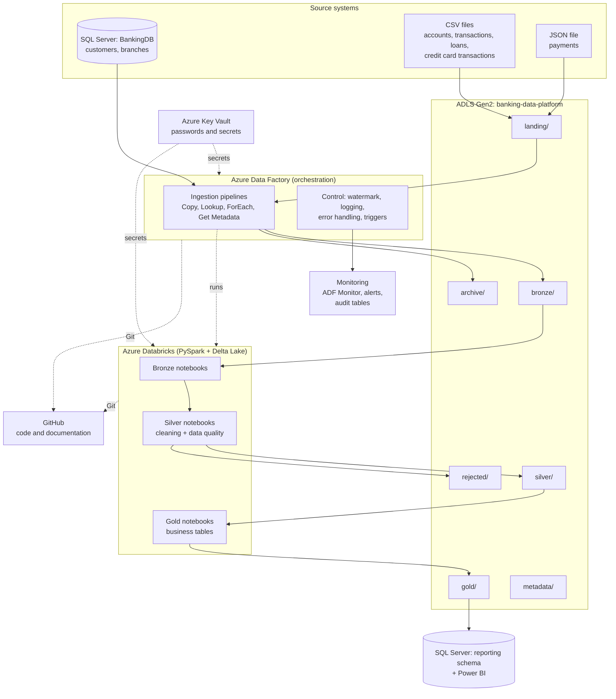

# Module 1: Project Introduction, Architecture and Prerequisites

> **Goal of this module:** understand *what* we are building, *why* each technology is used, and get your laptop and accounts ready. You will not create any Azure resource yet, so this module costs nothing.

**Time needed:** 2–3 hours

---

## 1. What is it?

We are building a **data platform for a fictional bank called "FinTrust Bank"**.

A *data platform* is a set of tools that:

1. **collects** data from many places (databases, files),
2. **stores** it safely in one central place,
3. **cleans** and **checks** it, and
4. **prepares** it so managers and analysts can answer business questions.

The work of building this is called **data engineering**. A data engineer builds the "pipes" that move data, not the reports themselves.

### Words you will hear in every module

| Term | Simple meaning | Banking example |
|---|---|---|
| **Source system** | Where the data is created | The core banking database that records every transaction |
| **Ingestion** | Copying data from a source into our platform | Copying yesterday's transactions every night at 1 AM |
| **Pipeline** | An automated sequence of steps | "Copy → check → clean → save" |
| **Batch processing** | Processing data in groups at a fixed time | One run per night for the whole day's data |
| **Data lake** | Cheap storage for files of any type and size | Folders holding CSV, JSON and Parquet files |
| **Schema** | The list of columns and their data types | `transaction_id` (text), `amount` (decimal), `transaction_ts` (timestamp) |
| **Primary key (PK)** | Column that uniquely identifies a row | `customer_id = C00001` |
| **Foreign key (FK)** | Column that points to a PK in another table | `accounts.customer_id` → `customers.customer_id` |
| **Data quality (DQ)** | Checking data is correct, complete and valid | An amount cannot be negative; a date cannot be 30 February |
| **Transformation** | Changing data into a better shape | Converting `"1,250.50"` (text) to `1250.50` (number) |
| **Incremental load** | Loading only *new or changed* data | Load only transactions after the last loaded timestamp |

---

## 2. Why do we need it?

### The business problem

FinTrust Bank has data in many disconnected places:

| Data | Source | Format | Problem today |
|---|---|---|---|
| Customers | Core banking database | SQL Server table | Duplicate customers, missing emails, bad dates of birth |
| Branches | Core banking database | SQL Server table | A duplicate branch row, a missing manager |
| Accounts | Daily file from the account system | CSV | Negative balances, accounts for customers that don't exist |
| Transactions | Daily file from the payment switch | CSV | Duplicates, negative or zero amounts, invalid dates, mixed formats |
| Loans | Daily file from the loan system | CSV | Negative principal, start dates in the future |
| Credit card transactions | Daily file from the card processor | CSV | Wrong amounts (`abc`), unknown customers |
| Payments | API export from the payments app | JSON (nested) | Missing fields, `NaN` amounts, different date formats |

Because of this, management **cannot trust** numbers like:

- *How much money was deposited yesterday?*
- *Which branch gave the most loans?*
- *Which customers are our top spenders on credit cards?*
- *How many loans are overdue (days past due > 90)?*

Every team calculates these in Excel, and every team gets a different answer.

### What our platform will deliver

1. **One central copy** of all data in Azure Data Lake Storage (ADLS Gen2).
2. **Automated nightly pipelines** in Azure Data Factory (ADF): no manual copying.
3. **Clean, validated data** produced by Azure Databricks (PySpark). Bad rows are moved to a `rejected` area with the reason, not silently lost.
4. **Business-ready tables**: customer 360, daily and monthly transactions, branch performance, loan summary, credit card spending.
5. **Results loaded back to SQL Server**, so reporting tools such as Power BI can use them.

---

## 3. Real-world example

Here is one transaction's journey through the platform:

1. A customer withdraws ₹5,000 at an ATM in Pune. The payment switch writes it to `transactions.csv` as `T0000123, A000045, 2026-01-15 09:30:00, WITHDRAWAL, 5000.00, ...`.
2. **01:00 AM:** ADF copies the file from `landing/` to `bronze/`, exactly as received.
3. **01:10 AM:** Databricks reads Bronze and checks the row: the account exists, the amount is greater than 0, the date is valid, and it isn't a duplicate. It passes, so it's written to **Silver**.
4. Another row has amount `-300`. It fails the check and goes to **`rejected/`** with the reason `NEGATIVE_AMOUNT`.
5. **01:20 AM:** Databricks adds the ₹5,000 to *Pune branch, 15 January, withdrawals* in the **Gold** table `gold_daily_transactions`.
6. **07:00 AM:** The branch manager opens the report and sees correct totals.

---

## 4. Architecture

### 4.1 The Medallion Architecture (Bronze → Silver → Gold)

A **medallion architecture** organizes data into three quality levels, like medals.

| Layer | What it holds | Rules | Why we need it | Banking example |
|---|---|---|---|---|
| **Bronze** (raw) | Data exactly as received, plus *who sent it and when* | Never change or delete. Add `_ingested_at` and `_source_file` | We can always reprocess from the original if a bug is found later. It also gives auditors proof of what we received | `transactions.csv` from 15 Jan, untouched |
| **Silver** (clean) | Cleaned, typed, de-duplicated, validated data | Correct data types, standard values, no duplicates, DQ rules applied | Analysts get one trusted version of each entity | Amount is a number, dates are real dates, `deposit` → `DEPOSIT` |
| **Gold** (business) | Aggregated, business-ready tables | Built for a specific business question | Reports become fast and simple, because the logic is written once | Total deposits per branch per day |

Two more folders support the layers:

| Folder | Purpose |
|---|---|
| `landing/` | Where source systems drop new files. Treated as an *inbox*, emptied after processing |
| `rejected/` | Rows that failed data quality, with the reason. Operations teams fix them at the source |
| `archive/` | Processed source files, kept for audit and re-processing |
| `metadata/` | Configuration files that tell pipelines *what* to load (used for metadata-driven pipelines in Module 7) |

### 4.2 End-to-end architecture



### 4.3 Data flow in plain English

1. **Ingest:** ADF reads `customers` and `branches` from SQL Server, and picks up CSV and JSON files from `landing/`.
2. **Land raw:** ADF writes everything to `bronze/` and moves the processed files to `archive/`.
3. **Clean:** ADF starts the Databricks notebooks. They read Bronze, apply data quality rules, write good rows to `silver/` (Delta tables) and bad rows to `rejected/`.
4. **Aggregate:** Gold notebooks build business tables in `gold/`.
5. **Serve:** Gold tables are copied to a SQL Server `reporting` schema for Power BI.
6. **Control:** a SQL Server control table stores the last loaded **watermark** for each source, so the next run loads only new data. Every run is written to an **audit log**.
7. **Secure:** passwords live in Key Vault, never in code or GitHub.

### 4.4 Why each technology?

| Technology | Role | Why this and not something else? |
|---|---|---|
| **Azure Data Factory** | Orchestration and copy | Point-and-click pipelines, 90+ connectors, scheduling, monitoring, no servers to manage. It *moves* data well but is not designed for complex transformations |
| **ADLS Gen2** | Data lake storage | Very cheap per GB, holds any file type, real folders (hierarchical namespace), fine-grained security, works natively with Spark |
| **Azure Databricks** | Transformation engine | Runs Apache Spark, which processes big data in parallel across many machines. Notebooks make learning easy |
| **PySpark** | Python API for Spark | Python is the most common data language. PySpark lets you write Spark logic in Python |
| **Spark SQL** | SQL on Spark | The same SQL you know, running on big data. Easy for SQL developers |
| **Delta Lake** | Table format on the lake | Adds database features to files: ACID transactions, `MERGE` (upsert), time travel, schema enforcement |
| **SQL Server** | Source database and reporting database | Most banks run relational databases. Teaches keys, joins, procedures and indexes |
| **Azure Key Vault** | Secret storage | Keeps passwords out of code, rotates keys centrally, and controls access with Azure roles |
| **GitHub** | Version control and portfolio | Tracks every change, enables teamwork, and shows recruiters your work |

### 4.5 SQL Server vs Spark SQL vs PySpark

| | SQL Server (T-SQL) | Spark SQL | PySpark |
|---|---|---|---|
| Runs on | One database server | A Spark cluster (many machines) | A Spark cluster |
| Best for | Transactions (OLTP), small/medium analytics, applications | Large-scale analytics written in SQL | Large-scale analytics plus complex logic, functions and loops |
| Data stored in | Database tables on disk | Files in a data lake (Delta, Parquet, CSV) | Files in a data lake |
| Example | `SELECT branch_id, SUM(amount) FROM dbo.transactions GROUP BY branch_id;` | Same SQL, against a Delta table | `df.groupBy("branch_id").agg(F.sum("amount"))` |
| In this project | Source data, control and audit tables, reporting | Gold queries and checks | Bronze and Silver cleaning |

The concepts are the same in all three: filter, join, group, window functions. Learning SQL Server makes Spark SQL easy, and Spark SQL makes PySpark easy.

---

## 5. Practical implementation: prerequisites

### 5.1 Accounts

| Account | Cost | Notes |
|---|---|---|
| **Azure subscription** | Free trial (credit for 30 days) or Pay-As-You-Go | Your existing subscription is fine. On a **Free Trial**, Databricks *Trial* pricing tier is blocked: choose **Premium** when you create the workspace (Module 8) |
| **GitHub** | Free | Use the account you already have (`kaustubhn36`) |
| **Microsoft account for SQL Server** | Free | Only needed to download tools |

### 5.2 Software to install on your laptop

| Tool | Why | Download |
|---|---|---|
| **SQL Server 2022 Developer Edition** | Free full-featured SQL Server for learning (our *source* database) | Search "SQL Server 2022 Developer download" on microsoft.com → choose **Basic** install |
| **SQL Server Management Studio (SSMS)** *or* **VS Code + mssql extension** | Run SQL queries | SSMS from microsoft.com; mssql extension from VS Code Extensions |
| **Git** | Version control | git-scm.com |
| **VS Code** | Edit Markdown, SQL and JSON | code.visualstudio.com |
| **Microsoft Integration Runtime** (later, Module 7) | Lets ADF reach your *local* SQL Server | Installed in Module 7 |
| **Python 3.10+** (optional) | Regenerate the datasets with `scripts/generate_datasets.py` | python.org |

> **Lower-cost alternative:** instead of a local SQL Server you can use **Azure SQL Database (free offer)**. It needs no self-hosted integration runtime. This guide uses a **local SQL Server**, because connecting on-premises data to the cloud is a key real-world skill and an interview favourite.

### 5.3 Naming convention used throughout

| Resource | Pattern | Name in this project |
|---|---|---|
| Resource group | `rg-<project>-<env>` | `rg-banking-dev` |
| Storage account (lowercase, 3–24 chars, globally unique) | `st<project><env><initials>` | `stbankingdevkn` |
| Container | — | `banking-data-platform` |
| Data Factory | `adf-<project>-<env>-<initials>` | `adf-banking-dev-kn` |
| Databricks workspace | `dbw-<project>-<env>` | `dbw-banking-dev` |
| Key Vault | `kv-<project>-<env>-<initials>` | `kv-banking-dev-kn` |
| SQL database | — | `BankingDB` |

Why a convention? With dozens of resources, the name tells you the **type**, **project** and **environment** at a glance. Several resources (storage, Key Vault, Data Factory) also need **globally unique** names, which is why we add initials.

### 5.4 Region

Choose **one** region and use it for every resource, for example **Central India** or **South India**. Data moving between regions is slower and can cost money. Some free-trial subscriptions restrict regions. If a resource fails with a "location not available" error, try another Indian region and keep everything there.

### 5.5 Cost plan (read this before Module 2)

| Service | Charged when | How we keep it cheap |
|---|---|---|
| ADLS Gen2 | Per GB stored + operations | Our data is < 5 MB, so practically free |
| Data Factory | Per activity run and data movement | A few cents per day of practice. Don't leave schedule triggers running |
| Databricks | Per minute a cluster runs (DBU + VM) | **Single-node cluster, auto-terminate after 15 minutes**. The biggest cost risk in this project |
| Key Vault | Per 10,000 operations | Practically free |
| SQL Server Developer (local) | Never | Free |

**Golden rules**

1. Put every resource in **one resource group**, so you can delete everything in one click when finished.
2. Set a **budget alert** in Cost Management (Module 2).
3. Always check that Databricks compute is **Terminated** before you close your laptop.

### 5.6 Learning roadmap and progress tracker

| # | Module | Main skills | Status |
|---|---|---|---|
| 1 | Project introduction, architecture, prerequisites | Concepts, medallion, tooling | ✅ Done |
| 2 | [Azure Resource Group](02-azure-resource-group.md) | Azure portal, RBAC basics, budgets | ✅ Done |
| 3 | [Storage Account and ADLS Gen2](03-storage-adls-gen2.md) | Hierarchical namespace, containers, upload data | ✅ Done |
| 4 | [SQL Server fundamentals and BankingDB](04-sql-server-bankingdb.md) | DDL, keys, joins, CTEs, window functions, procedures | ✅ Available |
| 5 | Azure Data Factory setup | Linked services, datasets, integration runtimes | ⬜ |
| 6 | ADF activities (one by one) | Copy, Lookup, Get Metadata, ForEach, If, Switch, Filter, variables | ⬜ |
| 7 | ADF pipelines 1–8 | SQL → lake, files, JSON, metadata-driven, watermark, logging | ⬜ |
| 8 | Azure Databricks setup | Workspace, compute, Unity Catalog, cost control | ⬜ |
| 9 | PySpark fundamentals | DataFrames, transformations, Spark SQL | ⬜ |
| 10 | Bronze layer | Schemas, corrupt records, Delta, partitioning | ⬜ |
| 11 | Silver layer | Data quality, rejected rows, MERGE, SCD Type 1 and 2 | ⬜ |
| 12 | Gold layer | Business tables, customer 360 | ⬜ |
| 13 | Incremental loading | Watermarks, control tables, upserts | ⬜ |
| 14 | Advanced engineering | Logging, audit, retries, monitoring, Key Vault | ⬜ |
| 15 | End-to-end testing | Test cases, reconciliation, expected results | ⬜ |
| 16 | GitHub publishing and resume | README, diagrams, interview preparation | ⬜ |

---

## 6. Explanation: the sample data

The `datasets/` folder contains **fictional** data for 3 months (January–March 2026). Names, emails, phone numbers and IFSC codes are all fake (`@example.com`, `FAKE0...`).

| File | Rows | Primary key | Foreign keys | Planted problems |
|---|---|---|---|---|
| `branches.csv` | 16 | `branch_id` | — | duplicate row, missing manager |
| `customers.csv` | 303 | `customer_id` | `home_branch_id` → branches | invalid and future dates, bad emails, extra spaces, mixed case, non-standard gender, unknown branch, duplicates, missing ID |
| `accounts.csv` | 451 | `account_id` | `customer_id`, `branch_id` | unknown customer, negative and missing balance, bad type/status/date, wrong currency, duplicate |
| `transactions.csv` | 3,006 | `transaction_id` | `account_id` | negative, zero, missing and `"1,250.50"` amounts, unknown/missing account, invalid dates, mixed formats, bad types, duplicates, a late status change |
| `loans.csv` | 121 | `loan_id` | `customer_id`, `branch_id` | unknown customer, negative principal, missing rate, outstanding > principal, future start, duplicate |
| `credit_card_transactions.csv` | 1,503 | `cc_txn_id` | `customer_id`, `card_id` | negative and non-numeric amount, missing category/time, unknown customer, lower case status, duplicates |
| `payments.json` | 601 | `payment_id` | `payer.account_id`, `payer.customer_id` | nested objects, negative and `NaN` amount, `null` account, missing field, other date format, duplicate |

Full column definitions are in [`datasets/README.md`](../datasets/README.md). **Finding** the problems is part of your learning. The complete list with row-by-row answers will come in Module 11 (Silver layer).

`payments.json` is in **JSON Lines** format (one JSON object per line). Spark reads this format by default.

---

## 7. Expected output (after this module)

- [ ] You can explain Bronze, Silver and Gold in your own words.
- [ ] SQL Server Developer and SSMS (or VS Code + mssql) are installed. You can connect to `localhost` and run `SELECT @@VERSION;`.
- [ ] Git is installed: `git --version` prints a version.
- [ ] You have downloaded this repository and can open the CSV files in Excel or VS Code.
- [ ] You have chosen your **region** and **initials** for resource names.

Example output of `SELECT @@VERSION;`:

```text
Microsoft SQL Server 2022 (RTM) - 16.0.xxxx.x (X64) ... Developer Edition (64-bit) ...
```

---

## 8. Common errors

| Problem | Cause | Solution |
|---|---|---|
| SSMS: *"A network-related or instance-specific error"* | SQL Server service not running, or wrong server name | Open **Services** → start **SQL Server (MSSQLSERVER)**. Server name: `localhost` (default instance) or `localhost\SQLEXPRESS` (Express) |
| SSMS: *"The certificate chain was issued by an authority that is not trusted"* | New SSMS versions encrypt by default | On the login screen tick **Trust server certificate** |
| `git` is not recognized | Git not on PATH | Re-open the terminal after installing, or reinstall with "Add to PATH" |
| CSV opens with everything in column A in Excel | Regional list separator is not a comma | Excel → **Data → From Text/CSV** → delimiter **Comma** |
| Excel changes `C00001` or dates | Excel auto-formats | Only *look* at data in Excel. Never save the CSV from Excel |

---

## 9. Practice assignment

1. **Install** SQL Server Developer, SSMS (or VS Code + mssql) and Git. Run `SELECT @@VERSION;` and take a screenshot.
2. **Create your GitHub repository** `banking-data-engineering` (public, with a README). Copy this project's files into it and push. You'll commit after every module.
3. **Explore the data** in VS Code or Excel and answer:
   1. How many **distinct** branches are there in `branches.csv`? Why is the row count different?
   2. Find **three** customers whose data has a problem. What is the problem in each?
   3. In `transactions.csv`, find one transaction ID that appears **twice**. Are the two rows identical?
   4. Which `transaction_type` values exist? Which ones look wrong?
   5. Open `payments.json`. Which fields are **nested** inside other objects?
4. **Draw** the architecture from section 4.2 on paper or in draw.io, in your own way. You'll use it in interviews.

Send me your answers to question 3. I'll check them before we start Module 2.

---

## 10. Interview questions

**1. What is a data lake, and how is it different from a data warehouse?**
A data lake stores raw data of any type (CSV, JSON, images, Parquet) cheaply, with the schema applied when you *read* it (schema-on-read). A data warehouse stores structured, modelled data in tables, with the schema enforced when you *write* it (schema-on-write). A **lakehouse** (Databricks + Delta Lake) combines both: lake storage with warehouse features such as ACID transactions.

**2. Explain the medallion architecture.**
Bronze holds raw data as received, plus ingestion metadata, for audit and reprocessing. Silver holds cleaned, validated, de-duplicated data with correct types. Gold holds business-level aggregates for reporting. Each layer adds quality, and you can always rebuild a later layer from an earlier one.

**3. Why not clean the data while copying it in ADF?**
ADF is an orchestration and data-movement tool. Complex, testable transformation logic belongs in Spark (Databricks). Keeping raw data unchanged in Bronze also means we can fix a bug in the cleaning logic and reprocess history.

**4. What is the difference between ETL and ELT?**
In ETL (Extract–Transform–Load) data is transformed *before* loading it into the target. In ELT (Extract–Load–Transform) data is loaded raw first and transformed *inside* the target platform. This project uses **ELT**: ADF loads raw data to the lake, and Databricks transforms it there.

**5. Why do we keep rejected records instead of deleting them?**
For auditability and data correction. The business must know *what* was rejected and *why*, so the source system can fix it. Deleting rows silently gives wrong totals with no explanation.

**6. What is the difference between full load and incremental load?**
A full load copies all data every time: simple, but slow and expensive for large tables. An incremental load copies only new or changed rows, usually tracked with a **watermark** column such as `last_modified_ts`.

**7. Why use Azure Key Vault?**
To keep secrets out of code and Git. Services read secrets at runtime using managed identities, access is controlled and audited, and passwords can be rotated in one place.

**8. What is the difference between Spark SQL and PySpark?**
Both run on the same Spark engine and produce the same execution plan. Spark SQL uses SQL syntax. PySpark uses the Python DataFrame API, which is better for reusable functions, loops and complex logic. You can mix both in one notebook.

---

✅ **When you've finished the assignment, reply "Module 1 done" with your answers, and we'll start Module 2: Azure Resource Group.**
