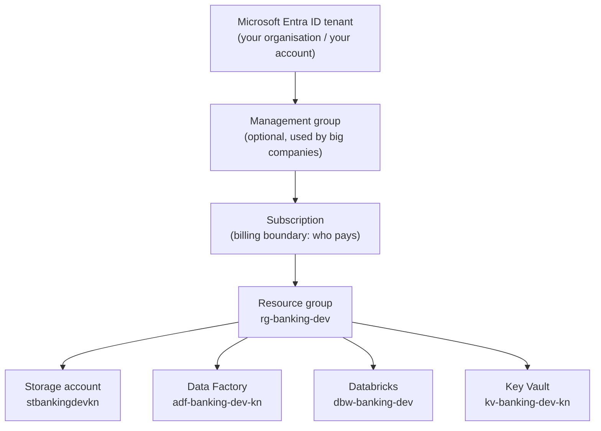

# Module 2: Azure Resource Group

> **Goal of this module:** create the one "folder" in Azure that will hold every resource of this project, label it with tags, register the services we will use, and protect your wallet with a **budget alert**. A resource group itself is **free**.

**Time needed:** 30–45 minutes
**Cost:** ₹0

---

## 1. What is it?

A **resource group** is a logical container in Azure. Every Azure resource (storage account, Data Factory, Databricks workspace, Key Vault) must live in exactly **one** resource group.

Think of it like a project folder on your laptop: the folder doesn't do any work itself, but it keeps all related files together so you can find them, share them, or delete them in one go.

### Where it sits in Azure



| Level | What it is | Example |
|---|---|---|
| **Tenant** | Your identity directory (users, groups, apps) | Your Microsoft account's directory |
| **Subscription** | A billing account. Every cost lands on a subscription | "Azure subscription 1" or "Pay-As-You-Go" |
| **Resource group** | A container for resources that share a lifecycle | `rg-banking-dev` |
| **Resource** | The actual service you use | Storage account, Data Factory |

### Key rules

- A resource belongs to **one** resource group at a time (you can move it later).
- A resource group has a **region**, but this only stores its *metadata*. Resources inside it can be in other regions. We still keep everything in one region for speed and cost.
- **Deleting a resource group deletes everything inside it.** This is the easiest way to clean up at the end.
- Permissions (RBAC), policies, locks, tags and budgets can be applied **at resource-group level** and are inherited by the resources inside.

---

## 2. Why do we need it?

| Need | How a resource group helps |
|---|---|
| **Organisation** | All banking-project resources in one place, not mixed with other experiments |
| **Cost tracking** | Cost Management can show "how much did `rg-banking-dev` cost this month?" |
| **Cost control** | A budget on the resource group emails you before you overspend |
| **Security** | Give a teammate *Reader* access to this group only, not your whole subscription |
| **Clean-up** | One click deletes the whole project when you are finished |
| **Environments** | Separate groups for `dev`, `test` and `prod` keep them isolated |

---

## 3. Real-world example

A real bank's data team typically has resource groups like:

| Resource group | Contents | Who can change it |
|---|---|---|
| `rg-banking-dev` | Developers' ADF, Databricks, storage | Data engineers (Contributor) |
| `rg-banking-test` | Same services, test copies of data | CI/CD pipeline, QA team |
| `rg-banking-prod` | Production platform with real data | Only the deployment pipeline; engineers get Reader |
| `rg-banking-shared` | Key Vault, networking, monitoring | Platform / security team |

When a developer accidentally breaks something in `dev`, `prod` is untouched, because permissions, policies and budgets are set per group.

In this learning project we only need **`rg-banking-dev`**.

---

## 4. Azure portal steps

> 👉 **Beginner?** Follow the picture-by-picture version instead: [Module 2 Lab: step by step](02-lab-azure-resource-group.md).

> Before you start: sign in at <https://portal.azure.com> with the account that has your subscription.

### Step 4.1: Check your subscription and your role

1. In the top search bar type **Subscriptions** and open it.
2. You should see one subscription with **Status: Active**. Note its **name** (not the ID).
3. Click the subscription → **Access control (IAM)** → **Check access** → **View my access**.
4. You should have the **Owner** role. Owner is needed later to assign roles to Data Factory and Databricks.

> 🔒 **Security tip:** your **Subscription ID** and **Tenant ID** are not passwords, but they identify your account. Don't paste them into GitHub, and blur them in any screenshot you commit.

### Step 4.2: Create the resource group

1. Search for **Resource groups** → click **+ Create**.
2. **Basics** tab:

   | Field | Value |
   |---|---|
   | Subscription | your subscription |
   | Resource group | `rg-banking-dev` |
   | Region | **(Asia Pacific) Central India** (or South India; use the same region for everything) |

3. Click **Next: Tags** and add these tags:

   | Name | Value |
   |---|---|
   | `project` | `banking-data-engineering` |
   | `environment` | `dev` |
   | `owner` | your initials, e.g. `kn` |
   | `cost-center` | `learning` |

4. Click **Review + create** → wait for **Validation passed** → **Create**.
5. Click **Go to resource group**. It will be empty. That's correct.

**Why tags?** Tags are key–value labels. In Cost Management you can filter or group costs by tag, e.g. "show me everything where `project = banking-data-engineering`". Companies often *require* tags such as `owner` and `cost-center` through Azure Policy.

### Step 4.3: Register the resource providers

Each Azure service is delivered by a **resource provider** (e.g. `Microsoft.DataFactory`). On a new subscription some are not registered yet, and creating that resource fails with *"The subscription is not registered to use namespace…"*. Register them now to avoid that error later.

1. Open **Subscriptions** → your subscription → left menu **Settings → Resource providers**.
2. Search for each provider below, select it and click **Register**:

   | Provider | Needed for | Module |
   |---|---|---|
   | `Microsoft.Storage` | ADLS Gen2 | 3 |
   | `Microsoft.DataFactory` | Azure Data Factory | 5 |
   | `Microsoft.Databricks` | Azure Databricks | 8 |
   | `Microsoft.Compute` | Databricks cluster VMs | 8 |
   | `Microsoft.Network` | Databricks virtual network | 8 |
   | `Microsoft.KeyVault` | Key Vault | 14 |
   | `Microsoft.ManagedIdentity` | Identities for ADF / Databricks | 5, 8 |

3. Refresh after 1–2 minutes. Each should show **Registered**.

### Step 4.4: Create a budget alert (most important step)

A budget **does not stop** your resources. It **sends an email** when spending crosses a threshold, so you notice a forgotten Databricks cluster before it eats your credit.

1. Open **`rg-banking-dev`** → left menu **Cost Management → Budgets** → **+ Add**.
2. **Create a budget** tab:

   | Field | Value |
   |---|---|
   | Scope | `rg-banking-dev` (already filled) |
   | Name | `budget-rg-banking-dev` |
   | Reset period | **Monthly** |
   | Creation date | today |
   | Expiration date | 1 year from today |
   | Amount | **1500** if billed in INR, or **20** if billed in USD |

3. Click **Next** → **Set alerts**. Add four conditions:

   | Type | % of budget | Meaning |
   |---|---|---|
   | Actual | 50 | You have already spent half |
   | Actual | 80 | Getting close |
   | Actual | 100 | Budget reached |
   | Forecasted | 100 | Azure *predicts* you will exceed it this month |

4. **Alert recipients (email):** your own email address.
5. Click **Create**.

> **Note:** cost data in Azure is updated a few times per day, not in real time. A budget is a safety net, not a replacement for stopping your Databricks cluster.
>
> **Free Trial users:** your subscription also has a **spending limit** that stops resources when the free credit runs out. The budget alert warns you *before* that happens. If **Budgets** is greyed out for your offer type, use **Cost Management → Cost alerts** and check **Cost analysis** after every practice session.

### Step 4.5 (optional): Try a resource lock

Locks protect important resources from accidental deletion.

1. In `rg-banking-dev` → **Settings → Locks** → **+ Add**.
2. Lock name `lock-no-delete`, Lock type **Delete** → **OK**.
3. Go to **Overview** → **Delete resource group** → type the name → Delete. You'll get an error saying the group is locked. ✅
4. Go back to **Locks** and **delete the lock**, otherwise you'll be blocked when cleaning up at the end.

In production, `rg-banking-prod` would keep a delete lock permanently.

---

## 5. Implementation: the same thing with Azure CLI

The portal is good for learning. In real jobs, infrastructure is created with **scripts** (Azure CLI, Bicep, Terraform) so it is repeatable. The same steps are in [`scripts/azure/01_resource_group.sh`](../scripts/azure/01_resource_group.sh).

**Run it in Azure Cloud Shell:**

1. In the portal, click the **Cloud Shell** icon `>_` in the top bar → choose **Bash**.
2. If asked about storage, choose **No storage account required** (avoids creating an extra billed storage account), select your subscription → **Apply**.
3. Paste and run:

```bash
# 1. Which subscription am I using? (shows name and state, not the ID)
az account show --query "{name:name, state:state, user:user.name}" -o table

# 2. Variables: change OWNER to your initials
RG="rg-banking-dev"
LOCATION="centralindia"
OWNER="kn"

# 3. Create the resource group with tags (safe to re-run: it just updates)
az group create \
  --name "$RG" \
  --location "$LOCATION" \
  --tags project=banking-data-engineering environment=dev owner="$OWNER" cost-center=learning \
  -o table

# 4. Register resource providers
for p in Microsoft.Storage Microsoft.DataFactory Microsoft.Databricks \
         Microsoft.Compute Microsoft.Network Microsoft.KeyVault Microsoft.ManagedIdentity; do
  az provider register --namespace "$p"
done

# 5. Check registration state
for p in Microsoft.Storage Microsoft.DataFactory Microsoft.Databricks \
         Microsoft.Compute Microsoft.Network Microsoft.KeyVault Microsoft.ManagedIdentity; do
  echo "$p: $(az provider show --namespace "$p" --query registrationState -o tsv)"
done

# 6. Show the resource group and its tags
az group show --name "$RG" --query "{name:name, location:location, tags:tags}" -o json
```

If you already created the group in the portal, step 3 simply confirms it. That property is called **idempotency**: running a script twice gives the same result, an important idea you will meet again in ADF pipelines.

> The budget is easiest to create in the portal (Step 4.4). CLI support for budget alerts is limited, so we don't script it.

---

## 6. Explanation

| Concept | What you did | Why it matters for this project |
|---|---|---|
| Resource group | Created `rg-banking-dev` | Holds storage, ADF, Databricks, Key Vault |
| Region | Central India | All later resources use the same region: lower latency, no cross-region data charges |
| Tags | project, environment, owner, cost-center | Filter costs and find resources; often mandatory at companies |
| Resource providers | Registered 7 namespaces | Prevents "not registered to use namespace" errors in Modules 3–14 |
| RBAC | Checked you are **Owner** | Needed to give ADF/Databricks access to storage (Modules 3, 5, 8) |
| Budget | 50/80/100% actual + 100% forecast | Email warning before credit runs out |
| Lock | Tried and removed | Understand how production is protected |

### RBAC in one minute

**RBAC (Role-Based Access Control)** answers "**who** can do **what** on **which scope**".

| Built-in role | Can do | Typical user |
|---|---|---|
| **Owner** | Everything, including granting access to others | You, on your learning subscription |
| **Contributor** | Create, change, delete resources, but **not** grant access | Data engineers in `dev` |
| **Reader** | View only | Auditors, managers, engineers in `prod` |

A role assigned on a resource group applies to **every resource inside it** (inheritance). Later we'll use **data-plane** roles like *Storage Blob Data Contributor*, which allow reading and writing files, not just managing the storage account.

---

## 7. Expected output

After this module you should have:

- [ ] Resource group **`rg-banking-dev`** in **Central India** (or your chosen region), **0 resources**
- [ ] 4 tags visible on the resource group **Overview** page
- [ ] 7 resource providers showing **Registered**
- [ ] Budget **`budget-rg-banking-dev`** with 4 alert conditions
- [ ] No lock left on the resource group

Cloud Shell `az group show` output should look like:

```json
{
  "location": "centralindia",
  "name": "rg-banking-dev",
  "tags": {
    "cost-center": "learning",
    "environment": "dev",
    "owner": "kn",
    "project": "banking-data-engineering"
  }
}
```

---

## 8. Common errors

| Error | Cause | Fix |
|---|---|---|
| `RequestDisallowedByPolicy` / "location not allowed" | Your subscription or company policy restricts regions | Choose another region (South India, Southeast Asia) and use it for everything |
| `AuthorizationFailed` | You are not Owner/Contributor on the subscription | Use your personal subscription, or ask the admin for Contributor on the group |
| "The subscription is not registered to use namespace 'Microsoft.X'" | Resource provider not registered | Step 4.3 |
| Resource provider stuck on **Registering** | Normal for a few minutes | Wait 5 minutes and refresh |
| **Budgets** page empty or greyed out | Some offer types or a very new subscription don't support budgets yet | Wait 24 hours, or use Cost alerts / Cost analysis manually |
| "Cannot delete resource group … locked" | A delete lock exists | Settings → Locks → delete the lock |
| Cloud Shell asks to create storage | First-time setup | Choose **No storage account required** |
| `az: command not found` on your laptop | Azure CLI not installed locally | Use Cloud Shell in the portal instead |

---

## 9. Practice assignment

**A. Do it in the portal**

1. Complete Steps 4.1–4.4 (4.5 is optional).
2. Take a screenshot of the resource group **Overview** showing region and tags. **Blur the Subscription ID.**

**B. Do it with CLI**

3. Open Cloud Shell and run the script from Section 5. Confirm the output matches Section 7.
4. Run `az group list -o table`. How many resource groups do you have? (If Cloud Shell or Network Watcher created extra groups like `NetworkWatcherRG`, that's normal.)

**C. Think**

5. Your team has `rg-banking-dev` and `rg-banking-prod`. A new intern needs to *see* prod but must not change anything. Which role, on which scope?
6. You want to delete everything at the end of the project. What is the single command? (Write it down, **don't run it**.)
7. Why do we register resource providers *now* instead of when we need them?

**D. GitHub**

8. Add the [`scripts/azure/01_resource_group.sh`](../scripts/azure/01_resource_group.sh) file and this doc to your repo, and update the README progress tracker (Module 2 ✅).

When finished, reply with your answers to **5, 6 and 7** and **"Module 2 done"**.

---

## 10. Interview questions

1. **What is a resource group, and how is it different from a subscription?**
   A subscription is the billing and access boundary; a resource group is a logical container inside a subscription for resources that share a lifecycle.

2. **Can resources in one resource group be in different regions?**
   Yes. The group's region only stores its metadata. Best practice is to keep related resources together to reduce latency and egress cost.

3. **What happens when you delete a resource group?**
   Every resource inside it is deleted. That's why production groups use delete locks.

4. **How would you organise resource groups for dev, test and prod?**
   One group per environment (and often per workload), with different RBAC, policies and budgets. Deploy with the same scripts or CI/CD so environments match.

5. **Owner vs Contributor vs Reader?**
   Owner = full control plus granting access. Contributor = full control without granting access. Reader = view only.

6. **What is the difference between a budget and a spending limit?**
   A budget only alerts (and can trigger automation through action groups). A spending limit (Free Trial, some offers) actually stops resources when the credit is used up.

7. **What are tags used for?**
   Cost allocation, ownership, automation (e.g. shut down everything tagged `environment=dev` at night) and governance through Azure Policy.

8. **What is a resource lock? Name the types.**
   A protection on a resource or group. **Delete (CanNotDelete)** blocks deletion; **Read-only** blocks any change.

9. **What is a resource provider?**
   The Azure service that supplies a resource type, e.g. `Microsoft.DataFactory`. It must be registered on a subscription before that resource type can be created.

10. **Why create infrastructure with scripts instead of the portal?**
    Repeatability, version control, review, and identical dev/test/prod environments (Infrastructure as Code).

---

⬅️ [Module 1: Project overview](01-project-overview.md) · ➡️ [Module 3: Storage Account and ADLS Gen2](03-storage-adls-gen2.md)
