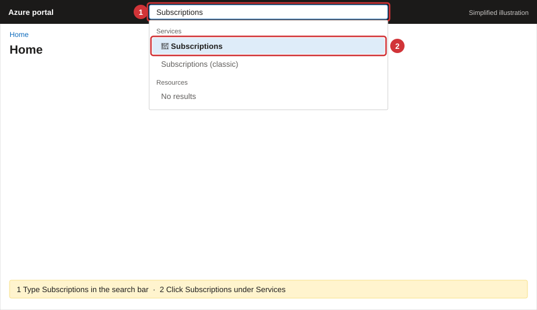
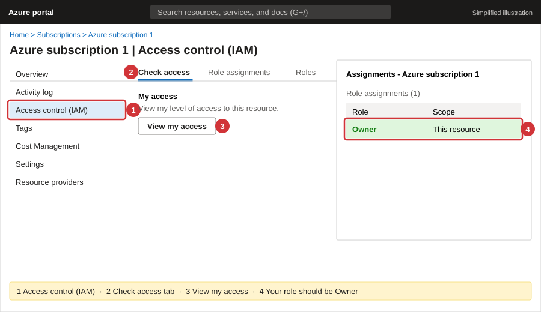
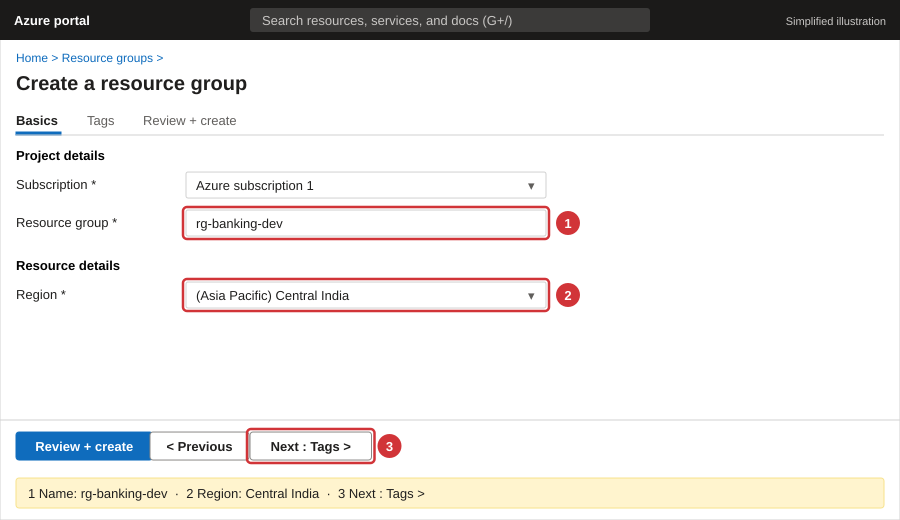
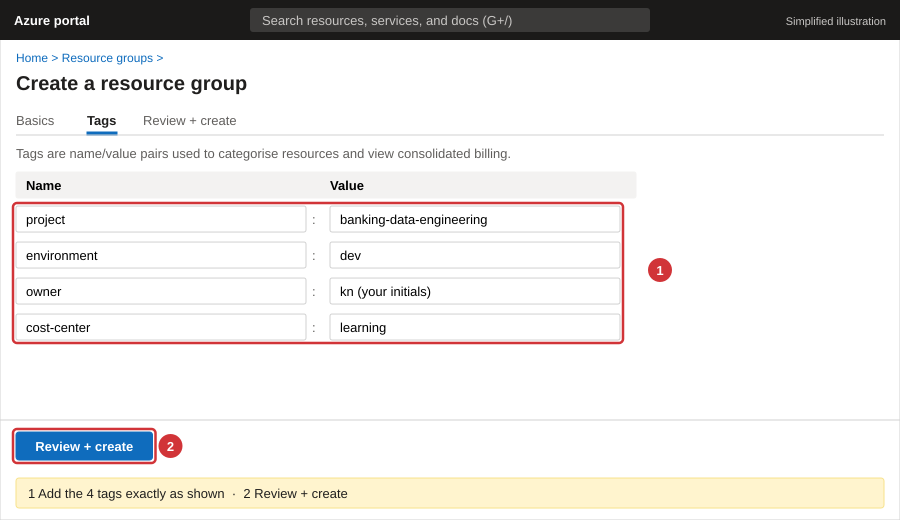
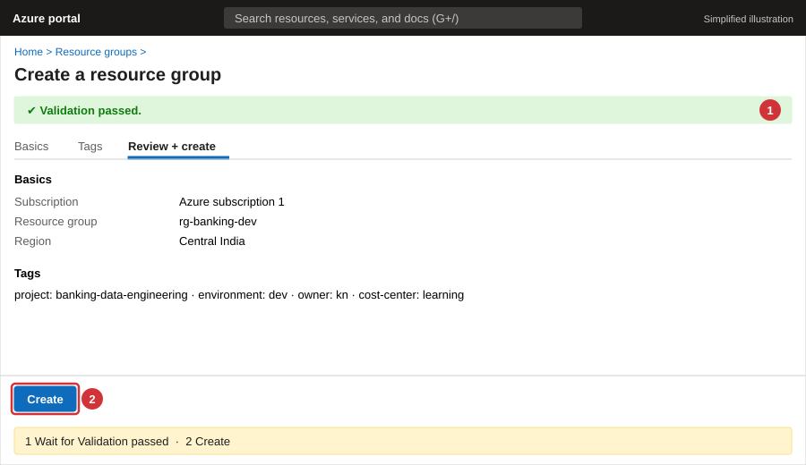
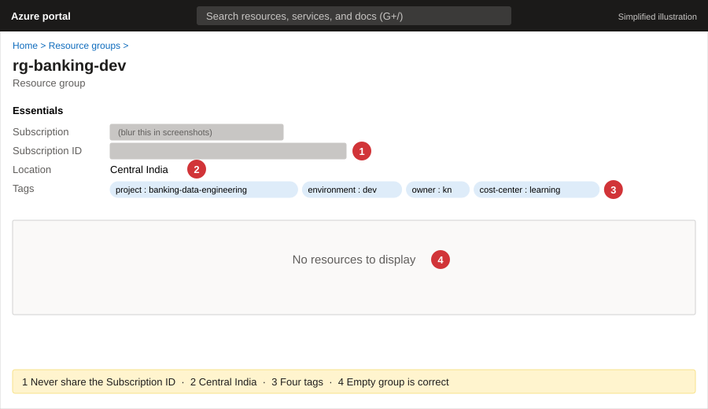
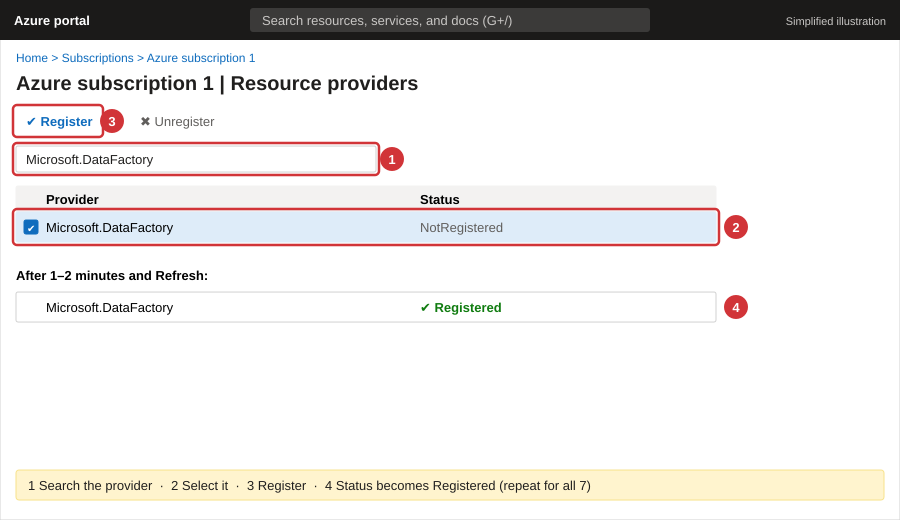
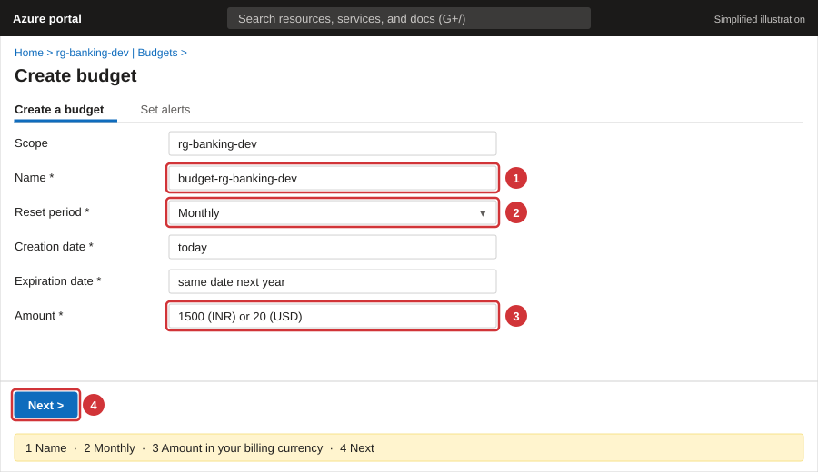
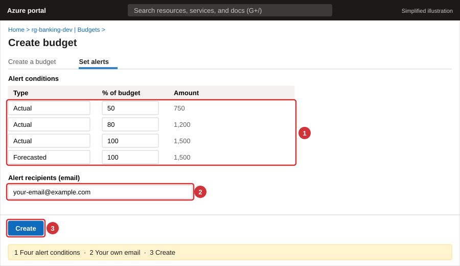
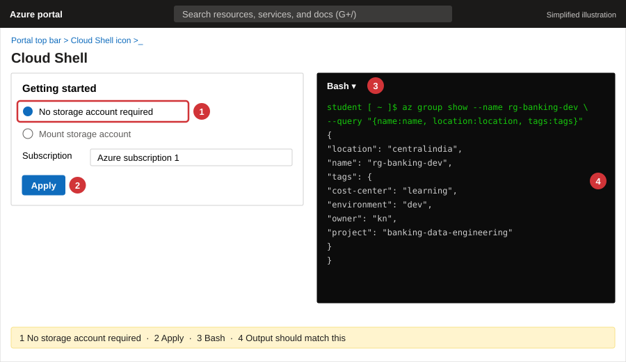

# Module 2 Lab: Create the Resource Group, Step by Step

> **Who is this for?** Complete beginners. Follow the steps in order, one at a time.
> **Time:** about 30–45 minutes · **Cost:** ₹0
> **Theory first?** The concepts (what a resource group is, RBAC, tags, budgets) are explained in [Module 2](02-azure-resource-group.md). This page is only the hands-on part.

## How to read the pictures

The pictures on this page are **simplified illustrations** of the Azure portal, not real screenshots. Microsoft changes the portal layout often, so your screen may look a little different, but the **names of the buttons and fields are the same**.

| Symbol | Meaning |
|---|---|
| 🔴 **1**, **2**, **3** | Red numbered circles: click or fill in that place, in that order |
| ✅ **Check** | What you should see when the step worked |
| ⚠️ **If it fails** | The most common problem and the fix |
| 📸 **Your screenshot** | Take a screenshot of your own screen for your notes |

### Taking your own screenshots safely

1. Press **Windows + Shift + S**, drag a box around the area, and the picture is copied.
2. Paste it into **Paint** (Ctrl+V), use the rectangle tool to **cover the Subscription ID, Tenant ID and your email**, then save it.
3. Keep your screenshots in a folder **outside** the project, for example `C:\Projects\my-screenshots\module-02\`. Don't upload them to the public GitHub repository.

---

## Progress checklist

Tick each box as you finish it.

- [ ] Step 1: Sign in to the Azure portal
- [ ] Step 2: Check that you are **Owner**
- [ ] Step 3: Create the resource group (Basics)
- [ ] Step 4: Add the tags
- [ ] Step 5: Review and create
- [ ] Step 6: Check the resource group
- [ ] Step 7: Register the 7 resource providers
- [ ] Step 8: Create the budget
- [ ] Step 9: Add the budget alerts
- [ ] Step 10: Repeat the setup with Azure CLI in Cloud Shell
- [ ] Step 11: Answer the 3 questions and report back

---

## Step 1: Sign in to the Azure portal

1. Open your browser and go to **<https://portal.azure.com>**.
2. Sign in with the Microsoft account that has your Azure subscription.
3. You land on the **Home** page.

✅ **Check:** you see "Microsoft Azure" at the top left and a search bar in the middle.

⚠️ **If it fails:** if it says you have no subscription, your free trial may have expired or you are signed in with a different account. Sign out (top-right picture → Sign out) and try the other account.

---

## Step 2: Check that you are Owner

You need the **Owner** role so that in later modules you can give Data Factory and Databricks permission to read your storage.

**2a. Open your subscription**



1. Click the **search bar** at the top and type `Subscriptions`.
2. Under **Services**, click **Subscriptions**.
3. Click the name of your subscription (for example *Azure subscription 1*).

**2b. View your access**



1. In the left menu, click **Access control (IAM)**.
2. Click the **Check access** tab.
3. Click **View my access**.
4. A panel opens on the right. Look at the **Role** column.

✅ **Check:** the role is **Owner**.

⚠️ **If it fails:** if you see *Contributor* or *Reader*, you are using someone else's subscription (for example your company's). Use your personal subscription for this project.

📸 **Your screenshot:** the panel showing **Owner** (blur the Subscription ID).

---

## Step 3: Create the resource group (Basics tab)

1. Click the search bar, type `Resource groups` and open **Resource groups**.
2. Click **+ Create** at the top left.



3. Fill in the **Basics** tab:

   | Field | What to enter |
   |---|---|
   | Subscription | Leave your subscription selected |
   | **Resource group** (🔴 1) | `rg-banking-dev` |
   | **Region** (🔴 2) | `(Asia Pacific) Central India` |

4. Click **Next : Tags >** (🔴 3).

💡 **Why these values?** `rg-` means *resource group*, `banking` is the project and `dev` is the environment (development). We use **Central India** for every resource in this project so they are close to each other and to you.

⚠️ **If it fails:** a red message under **Resource group** that says the name already exists means you created it before. Cancel, open the existing `rg-banking-dev`, and continue from Step 6.

---

## Step 4: Add the tags



1. Type the 4 tags one row at a time (🔴 1). A new empty row appears after each one.

   | Name | Value |
   |---|---|
   | `project` | `banking-data-engineering` |
   | `environment` | `dev` |
   | `owner` | your initials, e.g. `kn` |
   | `cost-center` | `learning` |

2. Click **Review + create** (🔴 2).

💡 **Why tags?** Tags are labels. Later you can open Cost Management and ask "how much did everything tagged `project = banking-data-engineering` cost?". Many companies don't let you create a resource without tags.

⚠️ **Watch out:** tag names are lowercase with a dash: `cost-center`, not `Cost Center`.

---

## Step 5: Review and create



1. Wait a few seconds until the green bar says **Validation passed** (🔴 1).
2. Check the summary: name, region and the 4 tags.
3. Click **Create** (🔴 2).
4. A notification appears at the top right: *Resource group created*. Click **Go to resource group**.

⚠️ **If it fails:** a red bar with *RequestDisallowedByPolicy* means your subscription doesn't allow this region. Click **< Previous**, choose **(Asia Pacific) South India**, and use South India for every later module too.

---

## Step 6: Check the resource group



Look at the **Overview** page of `rg-banking-dev`:

1. **Subscription ID:** never share this or upload it to GitHub. Blur it in screenshots.
2. **Location:** Central India.
3. **Tags:** all 4 tags are shown. If not, click **Tags** in the left menu and add the missing ones.
4. **No resources to display:** this is correct. The group is empty until Module 3.

✅ **Check:** name `rg-banking-dev`, location Central India, 4 tags, 0 resources.

📸 **Your screenshot:** this Overview page (blur the Subscription ID).

---

## Step 7: Register the 7 resource providers

A **resource provider** is the Azure service behind each resource type. If it isn't registered, creating that resource fails later with *"The subscription is not registered to use namespace…"*. We register them now so later modules go smoothly.

1. Open **Subscriptions** (as in Step 2a) → click your subscription.
2. In the left menu, scroll down to **Settings** → click **Resource providers**.



3. Do this for **each** provider in the table below:
   1. Type the provider name in the **filter box** (🔴 1).
   2. Click the row to **select** it (🔴 2).
   3. Click **Register** at the top (🔴 3).
   4. Clear the filter box and do the next one.

   | # | Provider | Needed for |
   |---|---|---|
   | 1 | `Microsoft.Storage` | ADLS Gen2 (Module 3) |
   | 2 | `Microsoft.DataFactory` | Azure Data Factory (Module 5) |
   | 3 | `Microsoft.Databricks` | Azure Databricks (Module 8) |
   | 4 | `Microsoft.Compute` | Databricks cluster machines (Module 8) |
   | 5 | `Microsoft.Network` | Databricks network (Module 8) |
   | 6 | `Microsoft.KeyVault` | Key Vault (Module 14) |
   | 7 | `Microsoft.ManagedIdentity` | Identities for ADF and Databricks |

4. Wait 1–2 minutes, then click **Refresh** at the top.

✅ **Check:** all 7 show **Registered** (🔴 4). Some, such as `Microsoft.Storage`, may already be registered. That's fine; skip them.

⚠️ **If it fails:** **Registering** for a long time is normal. Wait 5 minutes and refresh again.

📸 **Your screenshot:** the list showing the 7 providers as Registered.

---

## Step 8: Create the budget

A budget **emails you** when you spend money. It's your safety net if you forget to stop a Databricks cluster.

1. Open `rg-banking-dev` (search **Resource groups** → click it).
2. In the left menu, under **Cost Management**, click **Budgets**.
3. Click **+ Add**.



4. Fill in the form:

   | Field | What to enter |
   |---|---|
   | Scope | already `rg-banking-dev`; don't change it |
   | **Name** (🔴 1) | `budget-rg-banking-dev` |
   | **Reset period** (🔴 2) | `Monthly` |
   | Creation date | today (default) |
   | Expiration date | the same date next year |
   | **Amount** (🔴 3) | `1500` if the currency shown is INR (₹), or `20` if it is USD ($) |

5. Click **Next >** (🔴 4).

⚠️ **If it fails:** if **Budgets** is greyed out or shows an error, your subscription type may not support budgets yet (common for brand-new subscriptions). Wait 24 hours and try again. Meanwhile, check **Cost Management → Cost analysis** after every practice session.

---

## Step 9: Add the budget alerts



1. Under **Alert conditions** (🔴 1), add 4 rows:

   | Type | % of budget | You get an email when… |
   |---|---|---|
   | Actual | `50` | you have spent half |
   | Actual | `80` | you are getting close |
   | Actual | `100` | you have spent the full budget |
   | Forecasted | `100` | Azure *predicts* you will go over this month |

2. Under **Alert recipients (email)** (🔴 2), type **your own email address**.
3. Click **Create** (🔴 3).

✅ **Check:** the **Budgets** page lists `budget-rg-banking-dev` with your amount.

💡 **Remember:** a budget only **warns** you. It doesn't stop anything. The real protection is always stopping Databricks compute when you finish (Module 8).

📸 **Your screenshot:** the Budgets list.

---

## Step 10: Repeat the setup with Azure CLI in Cloud Shell

In real jobs, engineers create Azure resources with **scripts**, because a script can be saved in Git and run again. Here you'll see that running the script on an existing group is **safe**: it just confirms what's there.



1. In the portal's top bar, click the **Cloud Shell** icon `>_` (next to the search bar).
2. If it asks **Bash or PowerShell**, choose **Bash** (🔴 3).
3. On **Getting started**, choose **No storage account required** (🔴 1), select your subscription and click **Apply** (🔴 2).
4. Wait until you see a prompt ending in `$`.
5. Copy these commands and paste them into Cloud Shell (right-click → **Paste**, or **Shift+Insert**), then press **Enter**:

   ```bash
   RG="rg-banking-dev"
   LOCATION="centralindia"
   OWNER="kn"

   az group create --name "$RG" --location "$LOCATION" \
     --tags project=banking-data-engineering environment=dev owner="$OWNER" cost-center=learning \
     -o table

   az group show --name "$RG" --query "{name:name, location:location, tags:tags}" -o json
   ```

   Change `OWNER="kn"` to your own initials if they're different.

✅ **Check:** the last command prints the same JSON as the picture (🔴 4): location `centralindia`, name `rg-banking-dev` and the 4 tags.

6. Also run:

   ```bash
   az group list -o table
   ```

   Count how many resource groups you have. You need this for question 4 below.

⚠️ **If it fails:**

| Message | Fix |
|---|---|
| `ResourceGroupNotFound` | Typo in the name. It must be exactly `rg-banking-dev` |
| `InvalidResourceGroupLocation` | The group already exists in a different region. Use the region you chose in Step 3 |
| Cloud Shell asks to create storage | Go back and pick **No storage account required** |

The full script, including provider registration, is saved in the repository at [`scripts/azure/01_resource_group.sh`](../scripts/azure/01_resource_group.sh).

📸 **Your screenshot:** the JSON output.

---

## Step 11: Answer the questions and report back

Write your answers in your own words. Short answers are fine.

1. How many resource groups did `az group list -o table` show? Can you guess where any extra ones came from?
2. A new intern needs to **see** `rg-banking-prod` but must not change anything. Which **role**, and on which **scope**?
3. At the very end of the project you want to delete everything. Which **single command** does that? (Write it down, **don't run it**.)
4. Why did we register the resource providers **now** instead of waiting until we need them?

### What to send

1. Your 4 answers.
2. The screenshots from Steps 2, 6, 7, 9 and 10, with the Subscription ID blurred.
3. The words **"Module 2 done"**.

After that we start **Module 3: Storage Account and ADLS Gen2**, where `rg-banking-dev` gets its first resource and you upload the banking data to the cloud.

---

⬅️ [Module 2 theory](02-azure-resource-group.md) · 🏠 [Project README](../README.md)
