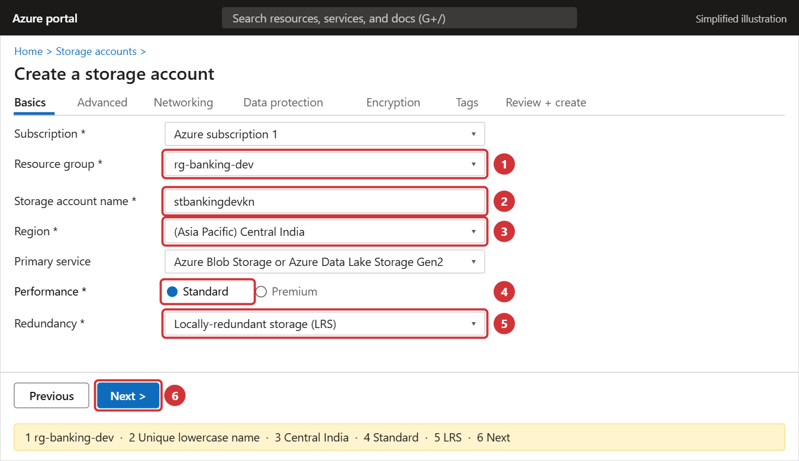
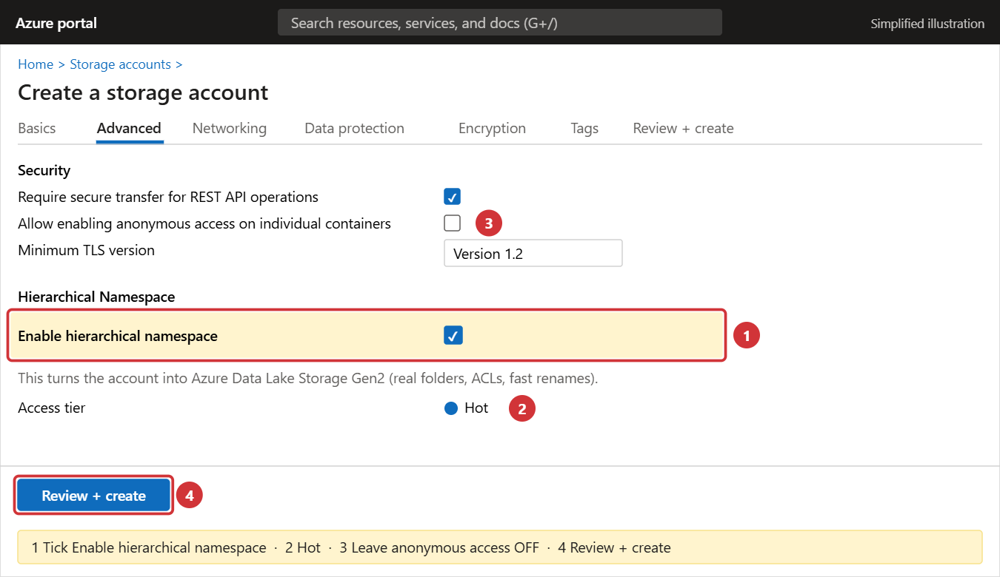
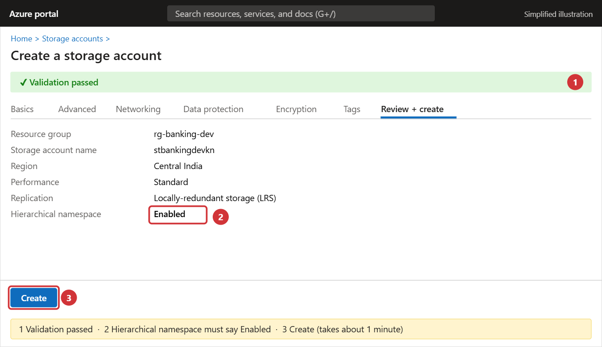
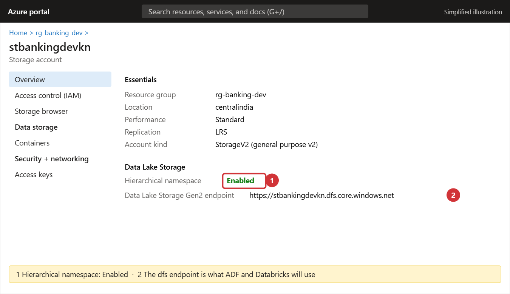
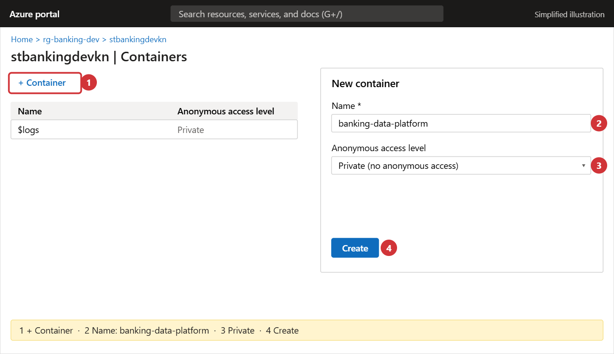
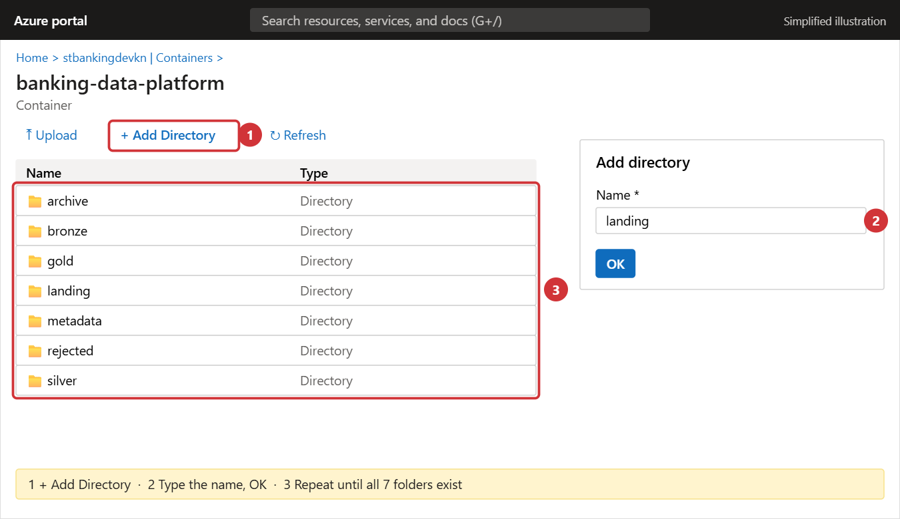
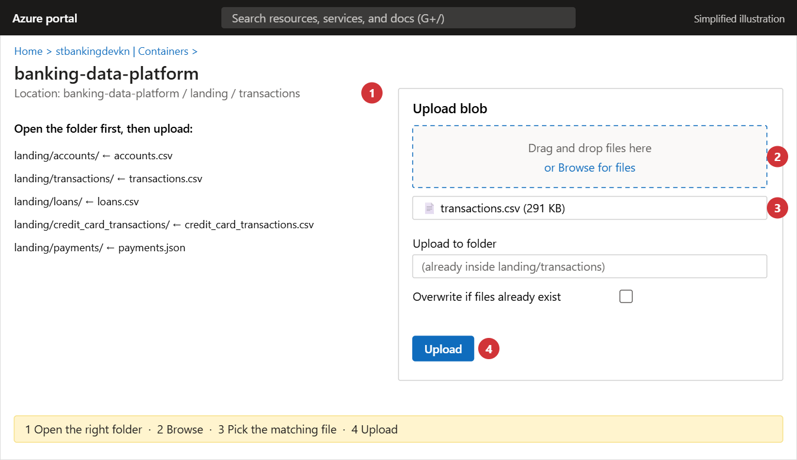
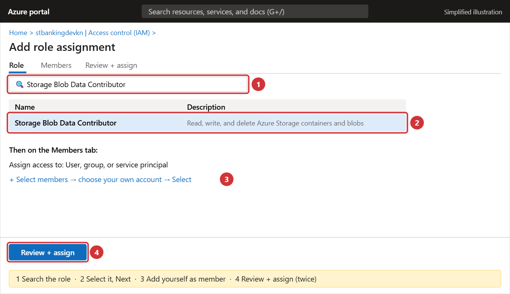
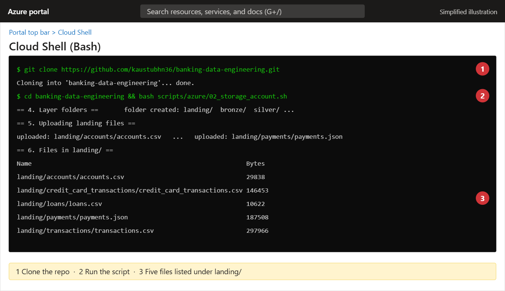
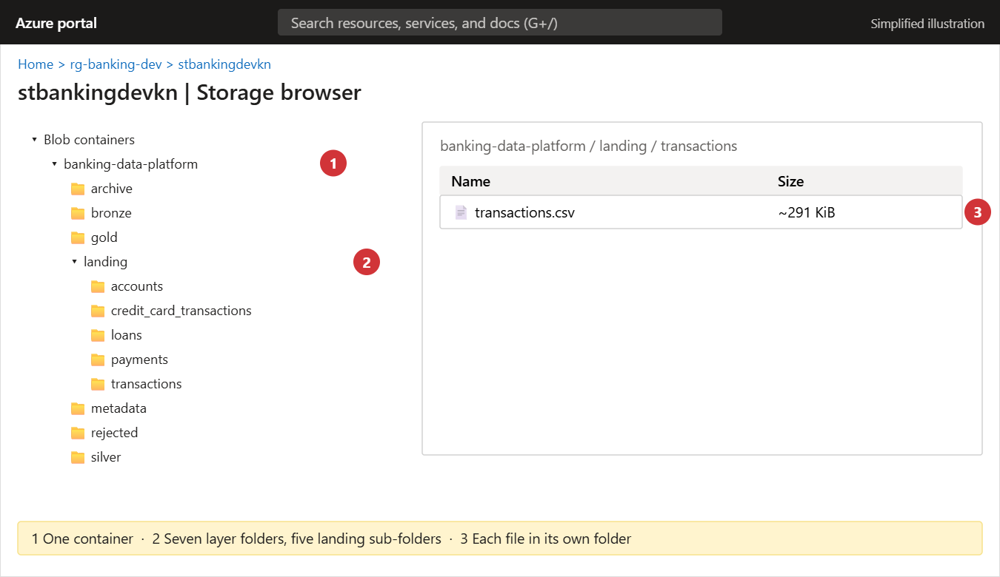

# Module 3 Lab: Create the Data Lake, Step by Step

> **Who is this for?** Complete beginners. Follow the steps in order, one at a time.
> **Time:** about 45–60 minutes · **Cost:** a few paise per month
> **Theory first?** What ADLS Gen2 is, and why we set it up this way, is explained in [Module 3](03-storage-adls-gen2.md). This page is only the hands-on part.
> **Before you start:** Module 2 must be done. You need the resource group `rg-banking-dev`, and the `Microsoft.Storage` provider must show **Registered**.

## How to read the pictures

The pictures are **simplified illustrations** of the Azure portal, not real screenshots, so your screen may look a little different. The **names of the buttons and fields are the same**.

| Symbol | Meaning |
|---|---|
| 🔴 **1**, **2**, **3** | Red numbered circles: click or fill in that place, in that order |
| ✅ **Check** | What you should see when the step worked |
| ⚠️ **If it fails** | The most common problem and the fix |
| 📸 **Your screenshot** | Take a screenshot of your own screen for your notes (blur the Subscription ID and email) |

---

## Progress checklist

- [ ] Step 1: Start creating the storage account (Basics)
- [ ] Step 2: Turn on hierarchical namespace (Advanced)
- [ ] Step 3: Review and create
- [ ] Step 4: Check the storage account
- [ ] Step 5: Create the container
- [ ] Step 6: Create the 7 folders
- [ ] Step 7: Upload the 5 source files
- [ ] Step 8: Give yourself access to the data
- [ ] Step 9: Repeat everything with Azure CLI in Cloud Shell
- [ ] Step 10: Look around the lake
- [ ] Step 11: Answer the questions and report back

---

## Step 1: Start creating the storage account (Basics tab)

1. Go to **<https://portal.azure.com>**.
2. In the search bar, type `Storage accounts` and open **Storage accounts**.
3. Click **+ Create**.



4. Fill in the **Basics** tab:

   | Field | What to enter |
   |---|---|
   | Subscription | your subscription |
   | **Resource group** (🔴 1) | `rg-banking-dev` |
   | **Storage account name** (🔴 2) | `stbankingdevkn` |
   | **Region** (🔴 3) | `(Asia Pacific) Central India` |
   | Primary service | leave the default, or choose *Azure Blob Storage or Azure Data Lake Storage Gen2* |
   | **Performance** (🔴 4) | `Standard` |
   | **Redundancy** (🔴 5) | `Locally-redundant storage (LRS)` |

5. Click **Next >** (🔴 6).

💡 **Why this name?** `st` = storage, `banking` = project, `dev` = environment, `kn` = your initials. Storage names must be **unique across all of Azure** and can only use **lowercase letters and numbers** (no hyphens).

⚠️ **If it fails:** if it says *"The storage account named stbankingdevkn is already taken"*, use `stbankingdevkn01` (or your own initials) and **write the name down**. You'll use it in every later module.

---

## Step 2: Turn on hierarchical namespace (Advanced tab)

This is the **most important** setting in this module. It turns normal Blob storage into **Azure Data Lake Storage Gen2**.



1. Under **Hierarchical Namespace**, tick **Enable hierarchical namespace** (🔴 1).
2. Leave **Access tier** as **Hot** (🔴 2).
3. Make sure **Allow enabling anonymous access on individual containers** is **not ticked** (🔴 3). Bank data must never be public.
4. Leave **Networking**, **Data protection** and **Encryption** on their defaults.
5. (Optional) On the **Tags** tab, add the same tags as Module 2: `project`, `environment`, `owner`, `cost-center`.
6. Click **Review + create** (🔴 4).

⚠️ **Don't skip the tick box.** If you forget it, you won't get real folders and you'll have to recreate the account.

---

## Step 3: Review and create



1. Wait for **Validation passed** (🔴 1).
2. Check that **Hierarchical namespace** says **Enabled** (🔴 2). If it says *Disabled*, click **< Previous** and go back to Step 2.
3. Click **Create** (🔴 3). It takes about a minute.
4. When it says *Your deployment is complete*, click **Go to resource**.

---

## Step 4: Check the storage account



On the **Overview** page:

1. Under **Data Lake Storage**, **Hierarchical namespace** shows **Enabled** (🔴 1).
2. Notice the **Data Lake Storage Gen2 endpoint** ending in `.dfs.core.windows.net` (🔴 2). ADF and Databricks will connect to this address.

✅ **Check:** resource group `rg-banking-dev`, location `centralindia`, Standard, LRS, HNS **Enabled**.

📸 **Your screenshot:** the Overview page.

---

## Step 5: Create the container

A **container** is the top-level folder in the storage account. We use one container for the whole project.

1. In the storage account's left menu, under **Data storage**, click **Containers**.



2. Click **+ Container** (🔴 1).
3. **Name** (🔴 2): `banking-data-platform`
4. **Anonymous access level** (🔴 3): **Private (no anonymous access)**
5. Click **Create** (🔴 4).

✅ **Check:** `banking-data-platform` appears in the list. (`$logs` is a system container; ignore it.)

---

## Step 6: Create the 7 folders

1. Click the container **banking-data-platform** to open it.



2. Click **+ Add Directory** (🔴 1).
3. Type `landing` and click **OK** (🔴 2).
4. Repeat for each folder until all 7 exist (🔴 3):

   | # | Folder | Purpose |
   |---|---|---|
   | 1 | `landing` | New source files arrive here |
   | 2 | `bronze` | Raw copy, never changed |
   | 3 | `silver` | Cleaned data |
   | 4 | `gold` | Business tables |
   | 5 | `rejected` | Bad rows with the reason |
   | 6 | `archive` | Processed source files |
   | 7 | `metadata` | Pipeline configuration |

5. Now open **landing** and, inside it, add 5 more folders:

   `accounts`, `transactions`, `loans`, `credit_card_transactions`, `payments`

⚠️ **If it fails:** if you see **Upload** but no **+ Add Directory**, hierarchical namespace is **off**. See *Common errors* in [Module 3](03-storage-adls-gen2.md#8-common-errors).

💡 **Spelling matters.** Later pipelines look for exactly these names. Use lowercase with an underscore in `credit_card_transactions`.

---

## Step 7: Upload the 5 source files

The files are in your project folder under `datasets\`.



Do this **5 times**, once per file:

1. Open the right folder first (🔴 1), for example `banking-data-platform / landing / transactions`.
2. Click **Upload**. In the pane, click **Browse for files** (🔴 2).
3. Pick the matching file from your `datasets` folder (🔴 3).
4. Click **Upload** (🔴 4).

| Open this folder | Upload this file |
|---|---|
| `landing/accounts/` | `accounts.csv` |
| `landing/transactions/` | `transactions.csv` |
| `landing/loans/` | `loans.csv` |
| `landing/credit_card_transactions/` | `credit_card_transactions.csv` |
| `landing/payments/` | `payments.json` |

💡 **Why not `customers.csv` and `branches.csv`?** In a real bank those live in a database. You'll load them into SQL Server in Module 4, and ADF will copy them into the lake in Module 7.

⚠️ **If it fails:** if a file ends up in the wrong place, select it, click **Delete**, open the correct folder and upload again.

---

## Step 8: Give yourself access to the data

Being **Owner** lets you *manage* the storage account, but reading and writing **files** with your sign-in needs a separate **data** role. (The theory is in [Module 3, section 5](03-storage-adls-gen2.md#5-security-how-do-you-get-into-the-lake).)

1. In the storage account's left menu, click **Access control (IAM)**.
2. Click **+ Add** → **Add role assignment**.



3. In the search box, type `Storage Blob Data Contributor` (🔴 1).
4. Click the role to select it (🔴 2), then click **Next**.
5. On the **Members** tab, keep **User, group, or service principal**, click **+ Select members**, search for your own name or email, click it and click **Select** (🔴 3).
6. Click **Review + assign** (🔴 4), and then **Review + assign** again on the last page.

✅ **Check:** **Access control (IAM)** → **Role assignments** lists you with **Storage Blob Data Contributor**.

⏱️ It can take **5–10 minutes** to take effect. Do Step 10 while you wait, then come back to Step 9.

---

## Step 9: Repeat everything with Azure CLI in Cloud Shell

The script creates nothing new if you did Steps 1–8 correctly. It **confirms** your setup and shows that the same work can be automated.



1. Open **Cloud Shell** (`>_` in the top bar) → **Bash**.
2. Clone your repository (🔴 1):

   ```bash
   git clone https://github.com/kaustubhn36/banking-data-engineering.git
   cd banking-data-engineering
   ```

   If you cloned it before, run `cd banking-data-engineering && git pull` instead.

3. **Only if your storage name is different** from `stbankingdevkn`, tell the script:

   ```bash
   export STORAGE=stbankingdevkn01
   ```

4. Run the script (🔴 2):

   ```bash
   bash scripts/azure/02_storage_account.sh
   ```

   It waits 60 seconds after the role step. That's normal.

✅ **Check:** the last table lists 5 files under `landing/` (🔴 3) with these sizes in bytes:

| File | Bytes |
|---|---|
| `landing/accounts/accounts.csv` | 29838 |
| `landing/credit_card_transactions/credit_card_transactions.csv` | 146453 |
| `landing/loans/loans.csv` | 10622 |
| `landing/payments/payments.json` | 187508 |
| `landing/transactions/transactions.csv` | 297966 |

⚠️ **If it fails:**

| Message | Fix |
|---|---|
| `AuthorizationPermissionMismatch` | The role from Step 8 hasn't taken effect yet. Wait 5 minutes and run the script again |
| `already taken` / `StorageAccountAlreadyTaken` | You're using a name that someone else owns. Run `export STORAGE=<your name>` first |
| `No such file or directory: datasets/...` | You're not inside the repo folder. Run `cd banking-data-engineering` |

📸 **Your screenshot:** the final table of 5 files.

---

## Step 10: Look around the lake

1. In the storage account's left menu, click **Storage browser**.



2. Expand **Blob containers → banking-data-platform** (🔴 1).
3. You should see the 7 folders and, inside `landing`, the 5 source folders (🔴 2).
4. Open `landing/transactions`. It contains `transactions.csv`, about 291 KiB (🔴 3).
5. Open `landing/payments`, click `payments.json` → **…** → **View/edit**. Find the nested `"amount": {"value": ..., "currency": "INR"}`.
6. Click **Access keys** in the left menu, just to see it. **Don't copy or share these keys.** Anyone who has one can read, change or delete everything in this account.

📸 **Your screenshot:** the Storage browser tree with all folders expanded.

---

## Step 11: Answer the questions and report back

Short answers in your own words are fine.

1. Why are the access keys in Step 10 more dangerous than signing in with your own account?
2. What's the difference between the `blob.core.windows.net` and `dfs.core.windows.net` addresses?
3. You're **Owner** of the subscription, but the CLI says *AuthorizationPermissionMismatch*. Why?
4. Why did we **not** upload `customers.csv` and `branches.csv`?

### What to send

1. Your 4 answers.
2. Screenshots from Steps 4, 9 and 10, with the Subscription ID and email blurred.
3. Your storage account name, if it's not `stbankingdevkn`.
4. The words **"Module 3 done"**.

Next is **Module 4: SQL Server fundamentals and BankingDB**, where you create the source database that ADF will read from.

---

⬅️ [Module 3 theory](03-storage-adls-gen2.md) · 🏠 [Project README](../README.md)
