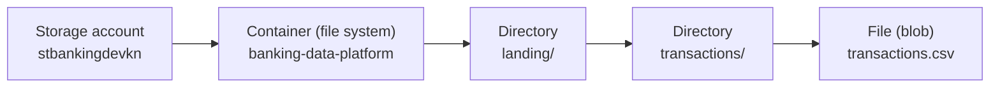

# Module 3: Storage Account and ADLS Gen2

> **Goal of this module:** create the data lake that every later module reads from and writes to, build the folder structure for the medallion layers, upload the source files, and learn how access to the lake is secured.
>
> 👉 **Beginner?** Do the hands-on part with the picture-by-picture guide: [Module 3 Lab: step by step](03-lab-storage-adls-gen2.md).

**Time needed:** 45–60 minutes
**Cost:** a few paise per month (our data is about 0.7 MB)

---

## 1. What is it?

### Storage account

An **Azure Storage account** is a place in Azure to keep data. One account can hold several kinds of storage:

| Service | Stores | Used in this project? |
|---|---|---|
| **Blob storage** | Files of any type (CSV, JSON, Parquet, images) | ✅ Yes, as ADLS Gen2 |
| File shares | Network drives (SMB) | No |
| Queues | Messages between apps | No |
| Tables | Simple key–value data | No |

### ADLS Gen2 = Blob storage + hierarchical namespace

**Azure Data Lake Storage Gen2 (ADLS Gen2)** is not a separate service. It is a storage account with one extra setting switched on: **hierarchical namespace (HNS)**.

| | Plain Blob storage (HNS off) | ADLS Gen2 (HNS on) |
|---|---|---|
| Folders | Fake: `landing/accounts/a.csv` is just a long file name | Real directories |
| Rename or move a folder | Copies every file one by one (slow, not atomic) | One fast, atomic operation |
| Permissions | Container level only | Per folder and per file (POSIX ACLs) |
| Endpoint | `https://<account>.blob.core.windows.net` | Also `https://<account>.dfs.core.windows.net` |
| Big data tools (Spark, Databricks, Synapse) | Work, but slower for folder operations | Designed for them (`abfss://` driver) |

Data engineering jobs constantly write to temporary folders and then rename them, so real folders matter. That's why every modern Azure data lake uses ADLS Gen2.

### The words you'll see



| Term | Meaning | Ours |
|---|---|---|
| Storage account | The top-level resource with a globally unique name | `stbankingdevkn` |
| Container (or *file system* in ADLS) | The top-level folder inside the account | `banking-data-platform` |
| Directory | A folder inside the container | `landing/`, `bronze/`, … |
| Blob (or file) | One file | `transactions.csv` |

A file's full address, as Spark will see it in Module 8:

```text
abfss://banking-data-platform@stbankingdevkn.dfs.core.windows.net/landing/transactions/transactions.csv
       └──── container ────┘ └─ account ──┘                       └──────── path ────────┘
```

---

## 2. Why do we need it?

- **One central place** for raw, clean and business data, used by ADF (Modules 5–7) and Databricks (Modules 8–13).
- **Cheap**: storing a GB costs around ₹1–2 per month on the Hot tier, far cheaper than a database.
- **Any format**: CSV, JSON, Parquet and Delta Lake all live side by side.
- **Separation of storage and compute**: data stays in the lake while Databricks clusters start and stop. You only pay for compute when it runs.

---

## 3. Real-world example

A bank's data lake usually separates layers and sources by folder, and controls access per folder:

| Folder | Who writes | Who reads |
|---|---|---|
| `landing/` | Source systems, SFTP jobs, ADF | Ingestion pipelines only |
| `bronze/` | ADF | Data engineers |
| `silver/` | Databricks | Data engineers, data scientists |
| `gold/` | Databricks | Analysts, Power BI, finance |
| `rejected/` | Databricks | Data quality and operations teams |

Because ADLS Gen2 supports folder-level permissions, a finance analyst can be given read access to `gold/` without ever seeing raw customer data in `bronze/`.

---

## 4. Design decisions for this project

| Setting | Our choice | Why |
|---|---|---|
| Name | `stbankingdevkn` | Lowercase letters and digits only, 3–24 characters, globally unique. If it's taken, add digits: `stbankingdevkn01` |
| Region | Central India | Same as the resource group |
| Performance | **Standard** | Premium is for very low latency and costs more |
| Redundancy | **LRS** (locally redundant) | Cheapest: 3 copies in one datacentre. Production banks use ZRS or GRS |
| Hierarchical namespace | **Enabled** | This is what makes it ADLS Gen2 |
| Access tier | **Hot** | Data is read often during development |
| Anonymous access | **Disabled** | Bank data must never be public |
| Minimum TLS | 1.2 | Security baseline |
| Container | One: `banking-data-platform` | Simple for learning; layers are folders. Large companies often use one container per layer |

### Folder structure

```text
banking-data-platform/
├── landing/                       ← source files arrive here (inbox)
│   ├── accounts/accounts.csv
│   ├── transactions/transactions.csv
│   ├── loans/loans.csv
│   ├── credit_card_transactions/credit_card_transactions.csv
│   └── payments/payments.json
├── bronze/                        ← raw copy written by ADF (Module 7)
├── silver/                        ← cleaned Delta tables (Module 11)
├── gold/                          ← business tables (Module 12)
├── rejected/                      ← rows that failed data quality (Module 11)
├── archive/                       ← processed source files (Module 7)
└── metadata/                      ← pipeline configuration (Module 7)
```

**Why a sub-folder per source?** Each source can then be loaded, archived and permissioned on its own, and a metadata-driven pipeline (Module 7) can loop over the folders.

`customers.csv` and `branches.csv` are **not** uploaded here. They come from SQL Server (Module 4) and ADF copies them into the lake (Module 7), just like in a real bank.

---

## 5. Security: how do you get into the lake?

| Method | What it is | Use it? |
|---|---|---|
| **Microsoft Entra ID + RBAC** | You (or ADF, or Databricks) sign in with an identity that has a role such as *Storage Blob Data Contributor* | ✅ **Yes.** No secret to leak |
| **Managed identity** | An identity Azure creates for ADF or Databricks, with no password at all | ✅ Yes, from Module 5 |
| Access keys | Two master keys with full control of the whole account | ❌ Avoid. Anyone with a key can do anything |
| SAS token | A signed URL that grants limited access for a limited time | Only for short-term sharing |

### Two kinds of roles

Azure has **two separate layers** of permission, and beginners often trip over this:

| Layer | Example role | Lets you |
|---|---|---|
| **Control plane** (manage the resource) | Owner, Contributor | Create or delete the storage account, change its settings |
| **Data plane** (touch the files) | **Storage Blob Data Contributor**, Storage Blob Data Reader | Read, write and delete files and folders |

Being **Owner** does **not** automatically let you read files with your Entra ID login. That's why the lab assigns you **Storage Blob Data Contributor**. Without it, CLI commands using `--auth-mode login` fail with `AuthorizationPermissionMismatch`.

> 🔒 **Never** copy an access key, SAS token or connection string into a notebook, script, README or screenshot. The script in this module uses only `--auth-mode login`. Keys go into Key Vault in Module 14.

---

## 6. Implementation

### Option A: Azure portal

Follow the [Module 3 Lab](03-lab-storage-adls-gen2.md). It has a picture for every screen.

### Option B: Azure CLI (Cloud Shell)

The script [`scripts/azure/02_storage_account.sh`](../scripts/azure/02_storage_account.sh) does everything: creates the account with HNS, gives you the data role, creates the container and 7 folders, uploads the 5 landing files and lists them.

```bash
# In Cloud Shell (Bash)
git clone https://github.com/kaustubhn36/banking-data-engineering.git
cd banking-data-engineering

# If your storage account has a different name, set it first:
# export STORAGE=stbankingdevkn01

bash scripts/azure/02_storage_account.sh
```

The key commands, explained:

| Command | What it does |
|---|---|
| `az storage account create ... --hns true` | Creates the account with hierarchical namespace, which makes it ADLS Gen2 |
| `az role assignment create --role "Storage Blob Data Contributor"` | Gives your user permission to read and write data |
| `az storage fs create` | Creates a container (`fs` = file system, the ADLS Gen2 name for a container) |
| `az storage fs directory create` | Creates a real folder |
| `az storage fs file upload --overwrite` | Uploads a file. `--overwrite` makes re-runs safe |
| `--auth-mode login` | Uses your Entra ID sign-in instead of an access key |

---

## 7. Expected output

- [ ] Storage account `stbankingdevkn` (or your variant) in `rg-banking-dev`, Central India, Standard, LRS
- [ ] Overview shows **Hierarchical namespace: Enabled**
- [ ] Container `banking-data-platform`, anonymous access **Private**
- [ ] 7 folders: `archive`, `bronze`, `gold`, `landing`, `metadata`, `rejected`, `silver`
- [ ] 5 files in `landing/`, each in its own sub-folder:

| Path | Size (bytes) |
|---|---|
| `landing/accounts/accounts.csv` | 29,838 |
| `landing/credit_card_transactions/credit_card_transactions.csv` | 146,453 |
| `landing/loans/loans.csv` | 10,622 |
| `landing/payments/payments.json` | 187,508 |
| `landing/transactions/transactions.csv` | 297,966 |

- [ ] You have **Storage Blob Data Contributor** on the storage account

---

## 8. Common errors

| Error | Cause | Fix |
|---|---|---|
| "The storage account named … is already taken" | Names are global across all of Azure | Add digits: `stbankingdevkn01`. Use that name in every later module |
| "The name can contain only lowercase letters and numbers" | Hyphens, underscores or capitals | Lowercase letters and digits only |
| No **Add Directory** button, only "Upload" | Hierarchical namespace was not enabled | HNS can't be switched off later, and switching it on later is a one-way upgrade. Easiest: delete this account and create it again with HNS ticked |
| `AuthorizationPermissionMismatch` / "This request is not authorized" | You don't have a **data** role, or it hasn't taken effect yet | Assign *Storage Blob Data Contributor* to yourself and wait 5–10 minutes |
| Portal says "You do not have permissions to list the data using your user account with Microsoft Entra ID" | Same as above | Same as above. Don't switch to access keys as a shortcut |
| `ResourceExistsError` on container create | It already exists | Fine. The script carries on |
| `No such file or directory: datasets/...` in Cloud Shell | Script was run outside the cloned repo | `cd banking-data-engineering` first |
| Uploaded file is in the container root instead of the folder | Upload pane was opened before entering the folder | Open the folder first, or set **Upload to folder** under Advanced |

---

## 9. Practice assignment

**A. Build it** (lab Steps 1–8)

1. Create the storage account with hierarchical namespace.
2. Create the container and the 7 folders.
3. Upload the 5 files into their `landing/` sub-folders.
4. Assign yourself **Storage Blob Data Contributor**.

**B. Prove it with CLI** (lab Step 9)

5. Run the script in Cloud Shell and confirm the 5 files and byte sizes match Section 7.

**C. Explore**

6. Open `landing/payments/payments.json` in **Storage browser → … → View/edit**. Find the nested `amount` field.
7. In the storage account, open **Access keys**. Look, but **don't copy or share** them. Why are these keys more dangerous than your Entra ID login?

**D. Think**

8. What's the difference between `blob.core.windows.net` and `dfs.core.windows.net`?
9. You're **Owner** of the subscription, but `az storage fs file list --auth-mode login` returns *AuthorizationPermissionMismatch*. Why?
10. Why do `customers.csv` and `branches.csv` **not** go into `landing/`?

When finished, reply with your answers to **7–10** and **"Module 3 done"**.

---

## 10. Interview questions

1. **What is ADLS Gen2, and how is it different from Blob storage?**
   It's Blob storage with hierarchical namespace enabled, which gives real directories, atomic renames and POSIX ACLs. It's optimised for analytics engines through the `abfss://` driver.

2. **What does `abfss://` mean?**
   Azure Blob File System, Secure. It's the Hadoop driver Spark uses to talk to the ADLS Gen2 `dfs` endpoint over TLS.

3. **Which redundancy would you choose for production banking data?**
   ZRS or GRS/GZRS. LRS keeps 3 copies in one datacentre only. Regulated data usually needs zone or region redundancy, depending on recovery requirements.

4. **Owner vs Storage Blob Data Contributor?**
   Owner is a control-plane role (manage the resource). Storage Blob Data Contributor is a data-plane role (read and write the data). One doesn't imply the other when signing in with Entra ID.

5. **How should ADF and Databricks authenticate to the lake?**
   With a managed identity or service principal that has a data-plane role. Don't use account keys. Any unavoidable secret goes in Key Vault.

6. **What are access tiers?**
   Hot (frequent access, higher storage cost), Cool (30 days minimum), Cold (90 days) and Archive (offline, hours to rehydrate). Lifecycle policies can move old files to cheaper tiers automatically.

7. **Why separate `landing/` from `bronze/`?**
   Landing is a temporary inbox in the source's format. Bronze is the permanent, append-only raw history with ingestion metadata added. Keeping them separate makes reprocessing and auditing simpler.

8. **How would you stop analysts from seeing raw PII in Bronze?**
   Give them access only to `gold/` (ACLs or separate containers/accounts), and mask or exclude PII when building Gold.

---

⬅️ [Module 2: Resource Group](02-azure-resource-group.md) · ➡️ [Module 4: SQL Server fundamentals and BankingDB](04-sql-server-bankingdb.md)
