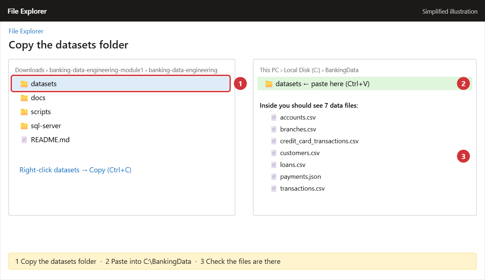
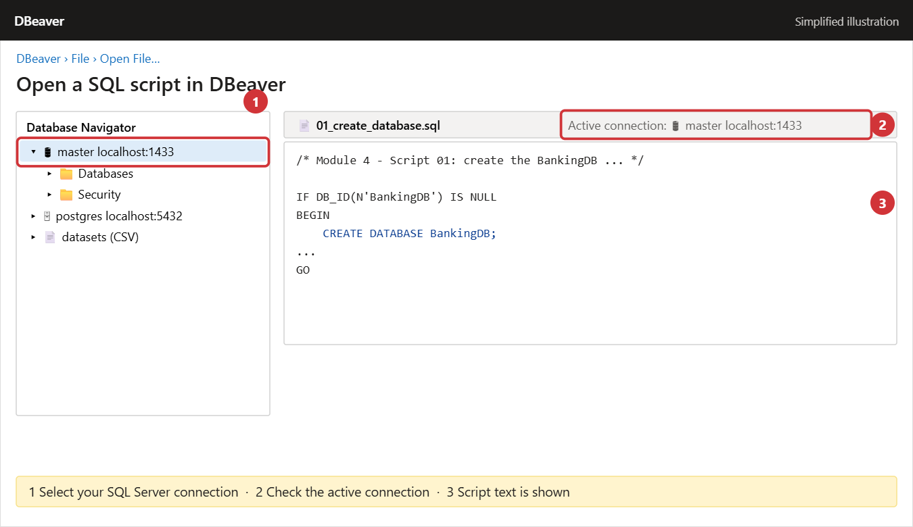
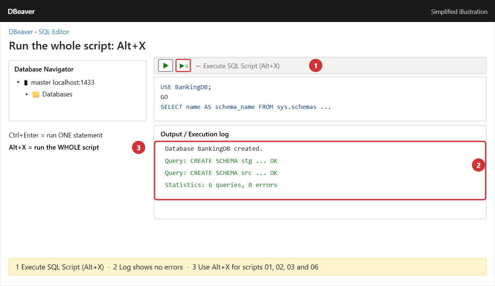
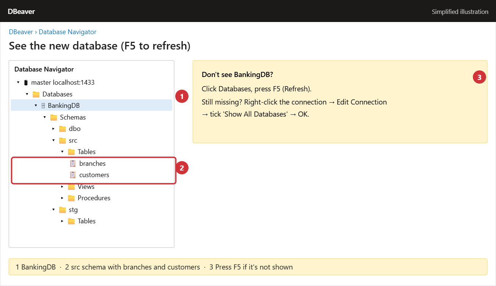
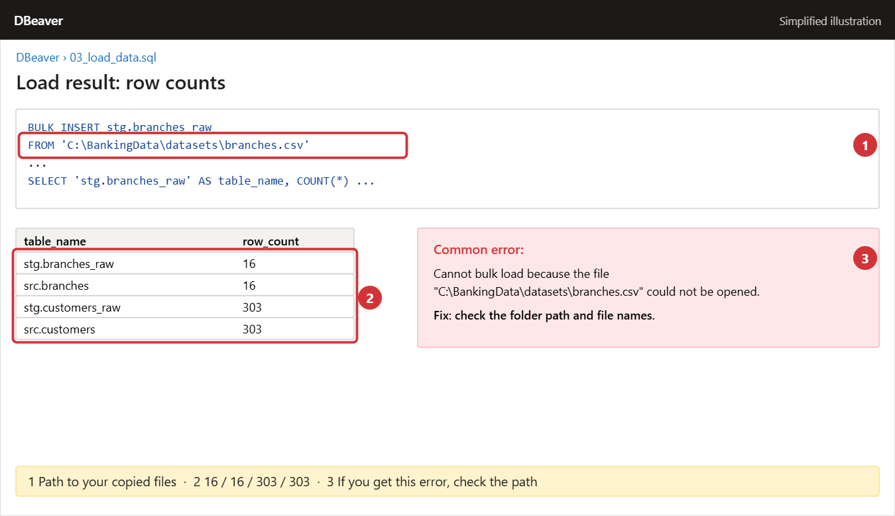
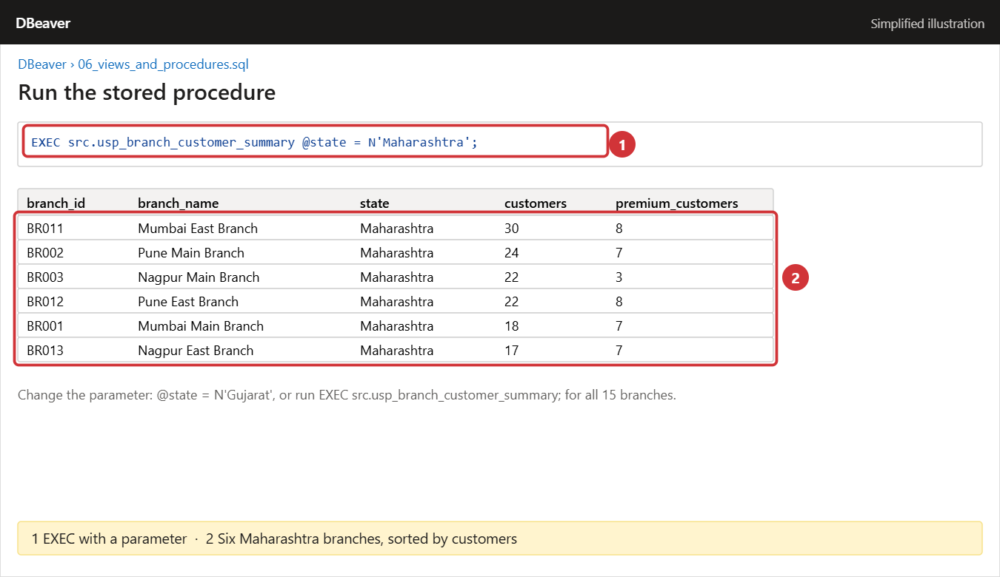
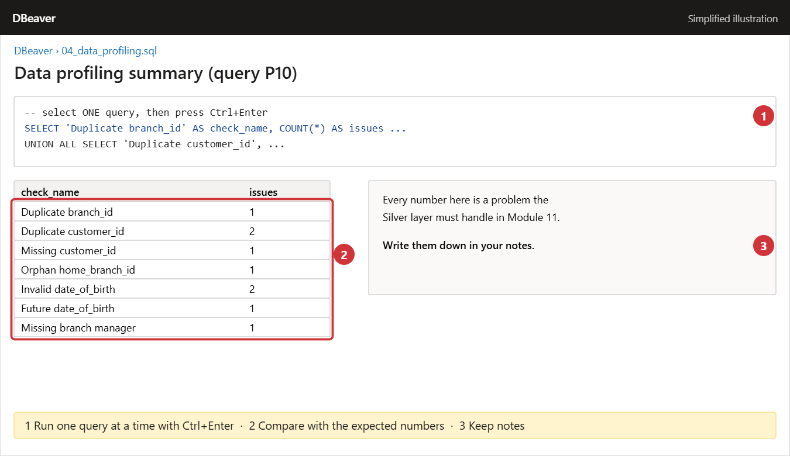

# Module 4 Lab: Build BankingDB, Step by Step

> **Who is this for?** Complete beginners. Follow the steps in order, one at a time.
> **Time:** about 1.5–2 hours · **Cost:** ₹0 (all on your laptop)
> **Theory first?** The concepts (schemas, keys, joins, window functions) are explained in [Module 4](04-sql-server-bankingdb.md). This page is only the hands-on part.
> **Before you start:** SQL Server Express is running and DBeaver connects to it with **Windows Authentication** on `localhost:1433` (you did this in Module 1).

## How to read the pictures

The pictures are **simplified illustrations** of File Explorer and DBeaver, not real screenshots, so your screen may look a little different. The **names of the buttons and menus are the same**.

| Symbol | Meaning |
|---|---|
| 🔴 **1**, **2**, **3** | Red numbered circles: click or check that place, in that order |
| ✅ **Check** | What you should see when the step worked |
| ⚠️ **If it fails** | The most common problem and the fix |
| 📸 **Your screenshot** | Take a screenshot for your notes |

### Two DBeaver shortcuts you'll use all the time

| Shortcut | What it runs | Use it for |
|---|---|---|
| **Alt+X** | The **whole** script, top to bottom | Scripts 01, 02, 03 and 06 |
| **Ctrl+Enter** | Only the statement under the cursor (or the text you selected) | Scripts 04 and 05, one query at a time |

---

## Progress checklist

- [ ] Step 1: Get the latest project files
- [ ] Step 2: Copy the data to `C:\BankingData`
- [ ] Step 3: Create the database (script 01)
- [ ] Step 4: Create the tables (script 02)
- [ ] Step 5: Load the data (script 03)
- [ ] Step 6: Create the view and procedure (script 06)
- [ ] Step 7: Profile the data (script 04)
- [ ] Step 8: Practise SQL (script 05)
- [ ] Step 9: Write 3 queries yourself
- [ ] Step 10: Answer the questions and report back

---

## Step 1: Get the latest project files

The SQL scripts are in the new `sql-server` folder of the repository.

1. Open **<https://github.com/kaustubhn36/banking-data-engineering>**.
2. Click the green **Code** button → **Download ZIP**.
3. Unzip it. You'll get a folder called `banking-data-engineering-main`.

✅ **Check:** inside there's a `sql-server` folder with 6 files, `01_create_database.sql` to `06_views_and_procedures.sql`.

💡 If the files are already in your project folder (`Downloads\banking-data-engineering-module1\banking-data-engineering\sql-server`), you can skip the download and use those.

---

## Step 2: Copy the data to `C:\BankingData`

SQL Server reads CSV files **itself**, so the files must be in a folder it's allowed to read. `Downloads` and `OneDrive` often aren't. A simple folder on `C:` is.



1. Open **File Explorer** and go to your project folder. Right-click the **datasets** folder → **Copy** (🔴 1).
2. Go to **This PC → Local Disk (C:)**. Create a new folder called `BankingData` and open it. Paste (**Ctrl+V**) (🔴 2).
3. Open `C:\BankingData\datasets` and check that the 7 data files are there (🔴 3).

✅ **Check:** the file `C:\BankingData\datasets\customers.csv` exists. Spelling matters.

⚠️ Don't open the CSV files in Excel and save them. Excel can change dates and the separator, and the load won't match the expected results.

---

## Step 3: Create the database (script 01)



1. Open **DBeaver**. In the **Database Navigator**, click your SQL Server connection (`master localhost:1433`) (🔴 1).
2. Menu **File → Open File…** → choose `sql-server\01_create_database.sql`.
3. Check the **active connection** at the top of the editor is your SQL Server connection (🔴 2). If it says *None* or `postgres`, click it and pick SQL Server.
4. You'll see the script (🔴 3).



5. Press **Alt+X** (or click **Execute SQL Script** in the editor's toolbar) (🔴 1).
6. Look at the **Output / Execution log** at the bottom (🔴 2).

✅ **Check:** "Database BankingDB created." and the last query returns 2 rows: `src`, `stg`.



7. In the Database Navigator, click **Databases** and press **F5** to refresh. **BankingDB** appears (🔴 1).

⚠️ **If BankingDB doesn't appear:** right-click your connection → **Edit Connection** → tick **Show All Databases** → **OK** (🔴 3).

---

## Step 4: Create the tables (script 02)

1. **File → Open File…** → `sql-server\02_create_tables.sql`.
2. Check the active connection, then press **Alt+X**.

✅ **Check:** the last query lists 4 tables: `src.branches`, `src.customers`, `stg.branches_raw`, `stg.customers_raw`. After **F5**, the navigator shows them under **BankingDB → Schemas → src / stg → Tables** (Step 3 picture, 🔴 2).

💡 Open `src.customers` in the navigator → **Properties** tab. Find `row_id` (primary key) and `modified_at` (default `SYSUTCDATETIME()`). The theory page explains why they're there.

---

## Step 5: Load the data (script 03)



1. Open `sql-server\03_load_data.sql`.
2. Check the two `FROM 'C:\BankingData\datasets\...'` paths match where you put the files in Step 2 (🔴 1).
3. Press **Alt+X**.

✅ **Check:** the result grid shows (🔴 2):

| table_name | row_count |
|---|---|
| stg.branches_raw | 16 |
| src.branches | 16 |
| stg.customers_raw | 303 |
| src.customers | 303 |

⚠️ **If it fails** (🔴 3):

| Message | Fix |
|---|---|
| `could not be opened. Operating system error code 3` | Path or file name is wrong. Compare it with File Explorer letter by letter |
| `Operating system error code 5 (Access is denied.)` | Files are in a folder SQL Server can't read. Use `C:\BankingData\datasets` |
| `You do not have permission to use the bulk load statement` | Make sure DBeaver connects with **Windows Authentication**, not a SQL login |

💡 The script empties the tables first, so you can run it again at any time to reset the data.

📸 **Your screenshot:** the row-count grid.

---

## Step 6: Create the view and procedure (script 06)



1. Open `sql-server\06_views_and_procedures.sql` and press **Alt+X**.
2. DBeaver opens a result tab for each `SELECT` / `EXEC`. Check:
   - The view returns **15** branches (16 rows minus the duplicate BR003).
   - The Maharashtra procedure call returns **6** rows (🔴 1, 🔴 2):

   | branch_id | branch_name | customers | premium_customers |
   |---|---|---|---|
   | BR011 | Mumbai East Branch | 30 | 8 |
   | BR002 | Pune Main Branch | 24 | 7 |
   | BR003 | Nagpur Main Branch | 22 | 3 |
   | BR012 | Pune East Branch | 22 | 8 |
   | BR001 | Mumbai Main Branch | 18 | 7 |
   | BR013 | Nagpur East Branch | 17 | 7 |

3. In a new line, try another state and run it with **Ctrl+Enter**:

   ```sql
   EXEC src.usp_branch_customer_summary @state = N'Gujarat';
   ```

📸 **Your screenshot:** the Maharashtra result.

---

## Step 7: Profile the data (script 04)

Profiling means **measuring** data quality before using the data.



1. Open `sql-server\04_data_profiling.sql`.
2. Click inside the first query (P1) and press **Ctrl+Enter** (🔴 1). Compare the result with the `-- Expected:` comment under it.
3. Repeat for P2 to P10, **one at a time**.

✅ **Check:** query P10 returns these numbers (🔴 2):

| check_name | issues |
|---|---|
| Duplicate branch_id | 1 |
| Duplicate customer_id | 2 |
| Missing customer_id | 1 |
| Orphan home_branch_id | 1 |
| Invalid date_of_birth | 2 |
| Future date_of_birth | 1 |
| Missing branch manager | 1 |

💡 Every number is a problem the Silver layer must handle in Module 11 (🔴 3). The full list is in [Module 4, section 6](04-sql-server-bankingdb.md#6-explanation-what-the-profiling-found).

⚠️ **If DBeaver runs too much:** press **Ctrl+Enter** with the cursor inside one query only. If a blank line inside a query confuses DBeaver, select the whole query with the mouse first, then press **Ctrl+Enter**.

---

## Step 8: Practise SQL (script 05)

This is where you learn the most, so take your time.

1. Open `sql-server\05_sql_practice.sql`.
2. For each exercise (E1 to E10):
   1. Read the **Question**.
   2. **Write your own query first** in a new script (**SQL Editor → New SQL script**, or **Ctrl+]**).
   3. Run it with **Ctrl+Enter** and compare with the `-- Expected:` comment.
   4. Only then look at the solution and run it.
3. For **E10**, remove the `--` at the start of the `ALTER TABLE` line and run it. You **should** get error **1505**. Read the message: it names the duplicate key `BR003`.

| Exercise | Skill | Key result |
|---|---|---|
| E1 | SELECT, WHERE, ORDER BY | 33 customers in Pune |
| E2 | INNER vs LEFT JOIN | 324 and 325 rows (not 303!) |
| E3 | GROUP BY, TOP | Maharashtra 92 |
| E4 | CTE + ROW_NUMBER dedup | 302 |
| E5 | DENSE_RANK | BR011 is rank 1 |
| E6 | Running total | 303 at the end of 2025 |
| E7 | % of total | RETAIL 69.3% |
| E8 | CASE standardisation | F 170, M 132, U 1 |
| E9 | Spot the difference | C00065 has two phone numbers |
| E10 | Constraints | Error 1505 on BR003 |

---

## Step 9: Write 3 queries yourself

No solutions are given. Send me your queries and I'll check them.

1. How many customers does each `kyc_status` have? Why are `verified` and `VERIFIED` counted together?
2. List the 5 oldest customers who have a **valid** date of birth.
3. For each state, show the branch with the most customers.

Hints are in [Module 4, section 9](04-sql-server-bankingdb.md#9-practice-assignment).

---

## Step 10: Answer the questions and report back

1. Why does the `INNER JOIN` in E2 return 324 rows instead of 303?
2. Why are dates stored as text in `src.customers`, and where will they be fixed?
3. Why did we load into `stg` first instead of straight into `src`?

### What to send

1. Your 3 queries from Step 9 and the 3 answers above.
2. Screenshots from Steps 5 and 6.
3. The words **"Module 4 done"**.

Next is **Module 5: Azure Data Factory setup**, where ADF connects to the lake and, through a self-hosted integration runtime, to this BankingDB on your laptop.

---

⬅️ [Module 4 theory](04-sql-server-bankingdb.md) · 🏠 [Project README](../README.md)
