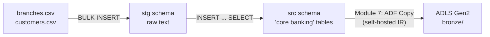

# Module 4: SQL Server Fundamentals and BankingDB

> **Goal of this module:** build the source database that Azure Data Factory will read from, load the branch and customer data into it, and practise the SQL you'll use for the rest of the project and in interviews: joins, aggregation, CTEs, window functions, views and stored procedures.
>
> 👉 **Beginner?** Do the hands-on part with the picture-by-picture guide: [Module 4 Lab: step by step](04-lab-sql-server-bankingdb.md).

**Time needed:** 1.5–2 hours
**Cost:** ₹0 (everything runs on your laptop)
**Tools:** SQL Server 2022 Express (or Developer) + DBeaver, both set up in Module 1

---

## 1. What is it?

In a real bank, customer and branch data lives in an **OLTP database**: the operational system that tellers and apps write to all day. In this project, **BankingDB** on your local SQL Server plays that role.



| Term | Meaning | In BankingDB |
|---|---|---|
| Database | A container for tables, views and code | `BankingDB` |
| Schema | A named group of objects inside a database | `stg`, `src` |
| Table | Rows and columns | `src.customers` |
| Primary key (PK) | Column(s) that uniquely identify a row | `row_id` |
| Foreign key (FK) | A column pointing to another table's key | `customers.home_branch_id` → `branches.branch_id` |
| View | A saved query you can select from | `src.vw_branches_current` |
| Stored procedure | Saved, parameterised SQL you run with `EXEC` | `src.usp_branch_customer_summary` |

### OLTP vs data lake (why both?)

| | OLTP database (BankingDB) | Data lake (ADLS Gen2) |
|---|---|---|
| Purpose | Run the bank: open accounts, update addresses | Analyse the bank: trends, reports, ML |
| Workload | Many small reads and writes | Few, very large reads |
| Data | Current state | Full history |
| Who queries it | Applications | Analysts, data scientists, BI tools |

Running heavy analytics directly on the OLTP database would slow down the systems customers use. That's why data engineers **copy** the data out to the lake.

---

## 2. Why do we need it?

- **A realistic source.** ADF reading from an on-premises SQL Server through a **self-hosted integration runtime** is one of the most common real-world patterns, and a frequent interview topic (Modules 5 and 7).
- **Incremental loads.** The `modified_at` column lets ADF copy only rows that changed since the last run (Module 13).
- **SQL skills.** Joins, window functions and CTEs come up in almost every data engineering interview, and the same logic appears again in Spark SQL.

---

## 3. Real-world example

A bank's core banking system has thousands of tables and doesn't always enforce clean data. Common legacy problems are dates stored as text, no unique constraint on the customer number, and branch codes that were retired but are still referenced. The data platform team can't fix the source system. It **profiles** the data, documents the problems, and cleans the data on the way into the lake.

That's exactly what you'll do: load the data as-is, profile it with SQL, and note every problem for the Silver layer (Module 11).

---

## 4. Database design

### Two schemas, two jobs

| Schema | Holds | Column types | Why |
|---|---|---|---|
| `stg` (staging) | The CSV exactly as read | All `NVARCHAR` (text) | `BULK INSERT` stops at the first value that doesn't fit the type. Loading as text first means the load never fails |
| `src` (source) | The "core banking" tables ADF will read | Text for messy columns, plus `row_id` and `modified_at` | Behaves like a real legacy system |

### `src.branches` and `src.customers`

| Column | Type | Why |
|---|---|---|
| `row_id` | `INT IDENTITY` **primary key** | A *surrogate key*: a number the database generates. We can't make `branch_id` or `customer_id` the PK because the data contains duplicates |
| Business columns | `VARCHAR` / `NVARCHAR` | Dates kept as text on purpose, so bad values like `15/08/1985` reach the lake |
| `modified_at` | `DATETIME2(3)`, default `SYSUTCDATETIME()` | When the row last changed (UTC). ADF's incremental load filters on it |

**Natural key vs surrogate key**

- **Natural (business) key:** has a business meaning, such as `customer_id = 'C00001'`.
- **Surrogate key:** has no meaning, only identifies the row (`row_id = 1, 2, 3…`).

Warehouses usually keep both: the surrogate key for joins and history, the natural key for business users.

### What is *not* in SQL Server

`accounts`, `transactions`, `loans`, `credit_card_transactions` and `payments` arrive as **files** (Module 3 uploaded them to `landing/`). Only `branches` and `customers` live in the database. Mixing database and file sources is normal in real projects.

---

## 5. Implementation

All scripts are in the [`sql-server/`](../sql-server/) folder. Run them **in order** in DBeaver.

| # | Script | What it does | How to run |
|---|---|---|---|
| 1 | [`01_create_database.sql`](../sql-server/01_create_database.sql) | Creates `BankingDB` and schemas `stg`, `src` | Whole script: **Alt+X** |
| 2 | [`02_create_tables.sql`](../sql-server/02_create_tables.sql) | Creates 2 staging + 2 source tables | Whole script: **Alt+X** |
| 3 | [`03_load_data.sql`](../sql-server/03_load_data.sql) | `BULK INSERT` the CSVs, copy staging → source | Whole script: **Alt+X** |
| 4 | [`04_data_profiling.sql`](../sql-server/04_data_profiling.sql) | 10 data quality checks | One query at a time: **Ctrl+Enter** |
| 5 | [`05_sql_practice.sql`](../sql-server/05_sql_practice.sql) | 10 SQL exercises with answers | One query at a time: **Ctrl+Enter** |
| 6 | [`06_views_and_procedures.sql`](../sql-server/06_views_and_procedures.sql) | A view and a stored procedure | Whole script: **Alt+X** |

### Key code explained

**Loading a CSV file**

```sql
BULK INSERT stg.customers_raw
FROM 'C:\BankingData\datasets\customers.csv'
WITH (FORMAT = 'CSV', FIRSTROW = 2, FIELDTERMINATOR = ',',
      ROWTERMINATOR = '0x0a', CODEPAGE = '65001', TABLOCK);
```

| Option | Meaning |
|---|---|
| `FORMAT = 'CSV'` | Understands quoted values such as `"1,250.50"` (SQL Server 2017+) |
| `FIRSTROW = 2` | Skips the header line |
| `ROWTERMINATOR = '0x0a'` | Line feed. Works for files saved on Linux (LF) and Windows (CRLF) |
| `CODEPAGE = '65001'` | UTF-8 |
| `TABLOCK` | Locks the table once instead of row by row: faster |

The path is read by the **SQL Server service on your machine**, so it must be a local folder the service can read. That's why we copy the data to `C:\BankingData\datasets` instead of loading from `Downloads`.

**Removing duplicates with `ROW_NUMBER()`.** You'll use this pattern again in PySpark.

```sql
WITH ranked AS (
    SELECT *,
           ROW_NUMBER() OVER (PARTITION BY branch_id
                              ORDER BY modified_at DESC, row_id DESC) AS rn
    FROM src.branches
)
SELECT * FROM ranked WHERE rn = 1;   -- latest row per branch_id
```

**Safe type conversion with `TRY_CONVERT`**

```sql
SELECT customer_id, date_of_birth
FROM src.customers
WHERE TRY_CONVERT(date, date_of_birth, 23) IS NULL;   -- NULL = not a valid yyyy-mm-dd date
```

`CONVERT` would stop the query with an error on `1990-02-30`. `TRY_CONVERT` returns `NULL` instead, so you can find the bad rows.

---

## 6. Explanation: what the profiling found

These are the problems in the two source tables. Write them down; they become the Silver-layer rules in Module 11.

| # | Table | Problem | Rows | Silver rule (Module 11) |
|---|---|---|---|---|
| 1 | branches | `BR003` appears twice (exact copy) | 1 key | Keep one row |
| 2 | branches | `BR014` has no manager | 1 | Allowed, set to `'UNKNOWN'` |
| 3 | customers | `C00060` duplicated (exact copy) | 1 key | Keep one row |
| 4 | customers | `C00065` duplicated with a **different phone** | 1 key | Keep latest, log the conflict |
| 5 | customers | Missing `customer_id` | 1 | Reject |
| 6 | customers | Home branch `BR999` doesn't exist (`C00050`) | 1 | Reject, or flag as orphan |
| 7 | customers | Impossible date `1990-02-30` (`C00020`) | 1 | Reject date, set to NULL |
| 8 | customers | Wrong date format `15/08/1985` (`C00055`) | 1 | Parse `dd/MM/yyyy` |
| 9 | customers | Birth date in the future `2030-05-01` (`C00025`) | 1 | Reject date, set to NULL |
| 10 | customers | Gender `Male` / NULL | 2 | Map to `M` / `U` |
| 11 | customers | KYC status `verified` (lowercase) | 1 | `UPPER()` |
| 12 | customers | Name `  rahul ` / `SHARMA ` (`C00030`) | 1 | `TRIM()` + proper case |
| 13 | customers | Email missing or invalid (`C00010`, `C00005`) | 2 | Flag as warning |

---

## 7. Expected output

- [ ] Database `BankingDB` with schemas `stg` and `src`
- [ ] Tables `stg.branches_raw`, `stg.customers_raw`, `src.branches`, `src.customers`
- [ ] Row counts: branches **16**, customers **303** (in both staging and source)
- [ ] Profiling summary (query P10): **1, 2, 1, 1, 2, 1, 1**
- [ ] View `src.vw_branches_current` returns **15** rows
- [ ] `EXEC src.usp_branch_customer_summary @state = N'Maharashtra'` returns **6** rows, starting with BR011 (30 customers)

---

## 8. Common errors

| Error | Cause | Fix |
|---|---|---|
| `Cannot bulk load because the file ... could not be opened. Operating system error code 3` | Folder or file name is wrong | Check `C:\BankingData\datasets\customers.csv` exists, exactly |
| Same message with `error code 5 (Access is denied.)` | SQL Server can't read that folder | Use `C:\BankingData`, not `Downloads` or `OneDrive` |
| `You do not have permission to use the bulk load statement` | Your login isn't a sysadmin | On SQL Server Express the Windows user who installed it is normally sysadmin. Connect with Windows Authentication |
| `Invalid object name 'src.customers'` | Scripts run out of order, or in the `master` database | Run 01 → 02 → 03. Each script starts with `USE BankingDB;` |
| `Bulk load data conversion error (truncation)` | A value is longer than the staging column | Not expected with these files. If you changed the CSV, widen the column |
| Last column of every row ends with an invisible character | File has Windows line endings | Already handled with `REPLACE(..., CHAR(13), '')` in script 03 |
| `BankingDB` doesn't appear in DBeaver | Navigator not refreshed | Select **Databases** → **F5**. Or Edit Connection → tick **Show All Databases** |
| `Msg 1505 ... duplicate key ... (BR003)` | Exercise E10, on purpose | That's the lesson: the source allows duplicates |

---

## 9. Practice assignment

**A. Build it** (lab Steps 1–6)

1. Run scripts 01, 02 and 03. Confirm 16 branches and 303 customers.
2. Run script 06. Confirm the view returns 15 rows and the procedure returns 6 rows for Maharashtra.

**B. Profile it** (lab Step 7)

3. Run all 10 queries in `04_data_profiling.sql` one by one and compare with the expected results.

**C. Practise SQL** (lab Step 8). For each exercise in `05_sql_practice.sql`, **write your own query first**, then compare with the solution.

**D. Write three new queries yourself**

4. How many customers does each `kyc_status` have? (Hint: `GROUP BY`. Notice `verified` and `VERIFIED` are grouped together. Why?)
5. List the 5 oldest customers with a **valid** date of birth. (Hint: `TRY_CONVERT` + `ORDER BY` + `TOP (5)`.)
6. For each state, show the branch with the most customers. (Hint: CTE + `ROW_NUMBER() OVER (PARTITION BY state ORDER BY customers DESC)`.)

**E. Think**

7. Why does `INNER JOIN` in exercise E2 return 324 rows instead of 303?
8. Why are dates stored as text in `src.customers`, and where will they be fixed?
9. Why did we load into `stg` first instead of straight into `src`?

When finished, reply with your answers to **4–9** and **"Module 4 done"**.

---

## 10. Interview questions

1. **INNER JOIN vs LEFT JOIN?**
   INNER returns only matching rows. LEFT returns every row from the left table, with NULLs where nothing matched. LEFT JOIN + `WHERE right.key IS NULL` finds orphans.

2. **Why can a join return *more* rows than the left table has?**
   When the right table has duplicate keys, each left row matches several right rows (fan-out). Always check uniqueness of the join key.

3. **`ROW_NUMBER` vs `RANK` vs `DENSE_RANK`?**
   For ties at 24: ROW_NUMBER gives 3, 4 (no ties). RANK gives 3, 3, then 5 (skips). DENSE_RANK gives 3, 3, then 4 (no gap).

4. **How do you remove duplicates in SQL?**
   `ROW_NUMBER() OVER (PARTITION BY key ORDER BY modified_at DESC)` and keep `rn = 1`. Use `DISTINCT` only for exact duplicates.

5. **What's a CTE and why use it?**
   A named sub-query defined with `WITH`. It makes long queries readable and lets you filter on window function results.

6. **`WHERE` vs `HAVING`?**
   WHERE filters rows before grouping. HAVING filters groups after aggregation.

7. **Surrogate vs natural key?**
   Natural keys carry business meaning and can change or duplicate. Surrogate keys are system-generated, stable and unique.

8. **View vs stored procedure?**
   A view is a saved SELECT used like a table. A procedure can take parameters, run several statements, modify data and handle errors.

9. **`CONVERT` vs `TRY_CONVERT`?**
   CONVERT raises an error on bad input. TRY_CONVERT returns NULL, which is ideal for data profiling and cleaning.

10. **How would you load only changed rows from this database?**
    Store the last `modified_at` you loaded (the *watermark*) in a control table. Next run: `WHERE modified_at > @last_watermark`, then update the watermark (Module 13).

---

⬅️ [Module 3: Storage Account and ADLS Gen2](03-storage-adls-gen2.md) · ➡️ Module 5: Azure Data Factory setup (next)
