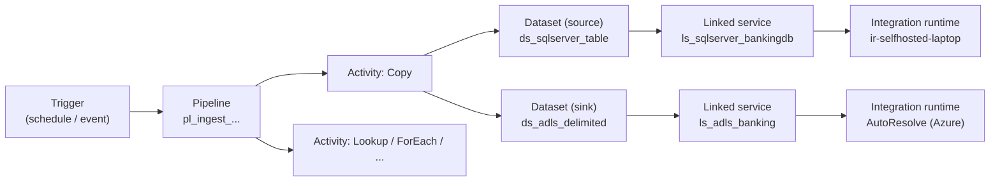
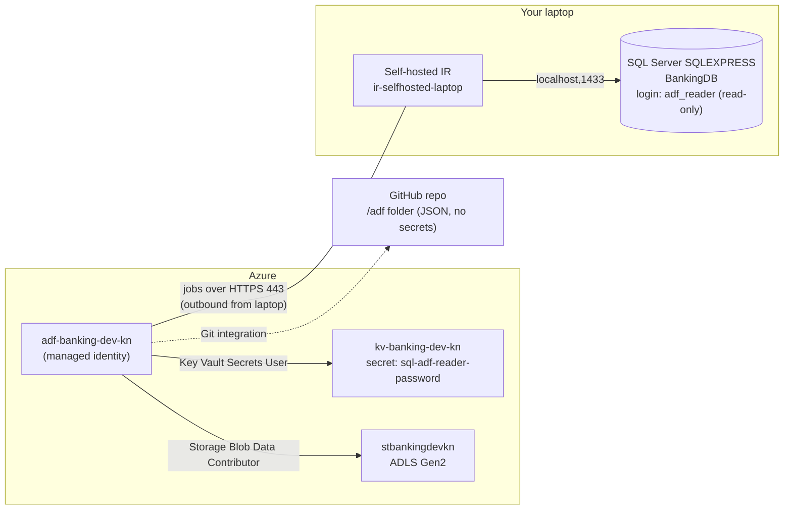

# Module 5: Azure Data Factory Setup

> **Goal of this module:** create Azure Data Factory (ADF), connect it to GitHub, and give it secure access to the two sources it will copy from: the data lake (ADLS Gen2) and BankingDB on your laptop (through a **self-hosted integration runtime**). The SQL password lives only in **Azure Key Vault**. Nothing secret is stored in ADF or GitHub.
>
> 👉 **Beginner?** Do the hands-on part with the picture-by-picture guide: [Module 5 Lab: step by step](05-lab-azure-data-factory-setup.md).

**Time needed:** 2–3 hours
**Cost:** practically ₹0. An idle Data Factory costs nothing; Key Vault charges about ₹0.25 per 10,000 secret reads; the self-hosted integration runtime is free software on your laptop.

---

## 1. What is it?

**Azure Data Factory** is Azure's cloud service for **moving and orchestrating data**. You build *pipelines* in a browser (ADF Studio) that copy data between systems, run transformations (for example Databricks notebooks), and run on a schedule or when a file arrives.

ADF doesn't store data itself. It **connects** to systems and **tells them what to do**.

### The building blocks



| Building block | Plain-English meaning | Analogy | Ours |
|---|---|---|---|
| **Linked service** | *How to connect* to a system: address + authentication | A saved phone contact | `ls_adls_banking`, `ls_sqlserver_bankingdb`, `ls_keyvault` |
| **Dataset** | *Which data* inside that system: a table, folder or file, and its format | The specific question you ask the contact | `ds_sqlserver_table`, `ds_adls_delimited` |
| **Activity** | One step of work: Copy, Lookup, ForEach, Execute Notebook… | One task on a to-do list | Module 6 |
| **Pipeline** | A group of activities that run together | The whole to-do list | Module 7 |
| **Trigger** | *When* a pipeline runs | An alarm clock | Module 7 |
| **Integration runtime (IR)** | *The compute* that actually moves the data | The delivery van | AutoResolve + `ir-selfhosted-laptop` |

### Three kinds of integration runtime

| IR type | Runs on | Reaches | Use in this project |
|---|---|---|---|
| **Azure IR** (AutoResolve) | Microsoft's cloud | Anything on the public internet / Azure | ADLS Gen2, Key Vault |
| **Self-hosted IR** | A machine **you** install it on | Private networks, on-premises servers, your laptop | SQL Server on your laptop |
| Azure-SSIS IR | Microsoft's cloud | Runs old SSIS packages | Not used |

**Why a self-hosted IR?** ADF lives in Azure and can't see `localhost` on your laptop. The self-hosted IR is a small Windows service that you install next to the database. It connects **outbound** to Azure (port 443), picks up work from ADF and talks to SQL Server locally. No inbound firewall port has to be opened. Banks connect on-premises core systems to the cloud in exactly this way.

---

## 2. Why do we need it?

- **Orchestration:** one place that runs the whole flow (SQL → lake → Databricks → SQL) in the right order, with retries and alerts.
- **Connectors:** 90+ built-in connectors, including SQL Server, ADLS, Snowflake, SAP, REST APIs and SFTP.
- **Low code, but versioned:** pipelines are built visually, yet every object is a JSON file saved in Git.
- **Hybrid:** the self-hosted IR bridges on-premises and cloud securely.

---

## 3. Real-world example

A bank's nightly batch:

1. 01:00: a **schedule trigger** starts `pl_daily_load`.
2. ADF copies yesterday's changed customers from the on-premises core banking database (through a **self-hosted IR** on a server in the bank's data centre) to `bronze/` in the lake.
3. ADF copies the card network's files that arrived on SFTP into `bronze/`.
4. ADF runs Databricks notebooks for Silver and Gold.
5. ADF writes the run result to an audit table and emails the support team if anything failed.

Passwords for the core database and SFTP are stored in **Key Vault**. ADF reads them at run time with its **managed identity**, so no human ever types them into ADF and they never appear in Git.

---

## 4. Security design for this module



| Connection | How ADF authenticates | Secret stored where? |
|---|---|---|
| ADF → ADLS Gen2 | ADF's **system-assigned managed identity**, role *Storage Blob Data Contributor* | Nowhere: no secret exists |
| ADF → Key Vault | Managed identity, role *Key Vault Secrets User* | Nowhere |
| ADF → SQL Server | SQL login `adf_reader` (read-only), password fetched from Key Vault | Only in Key Vault |
| Laptop IR → ADF | Registered once with an **authentication key** | Encrypted on the laptop by the IR. Never in Git |

### What a managed identity is

A **managed identity** is an identity in Microsoft Entra ID that Azure creates for a resource (here, the Data Factory) and manages for you. There's no password or key to rotate or leak. You give it roles exactly like a user.

### Why a separate, read-only SQL login?

**Least privilege**: ADF only needs to **read** source tables, so `adf_reader` is only in `db_datareader`. If its password ever leaked, nobody could change or delete data with it. Never let pipelines connect as `sa` or as your own Windows account.

### Why is Key Vault introduced already in Module 5?

Because the moment ADF is connected to a **public** GitHub repo, every linked service is saved as JSON in that repo. If you typed the password straight into the linked service, it would be saved alongside it (encrypted, but still something to avoid). With a Key Vault reference, the JSON holds only the vault's name and the secret's **name**, which are safe to publish.

---

## 5. Git integration: Save vs Publish

| Mode | Where your changes go | When they run |
|---|---|---|
| **Live mode** (no Git) | Directly into the factory | Immediately |
| **Git mode** (what we use) | **Save** → a commit to the `main` branch, folder `/adf` | Only after **Publish** |

```text
ADF Studio ──Save──► GitHub main:/adf/*.json          (your source code, reviewable)
           ──Publish► the live factory  +  adf_publish branch (ARM templates for CI/CD)
```

The `adf/` folder that appears in your repo will look like this:

```text
adf/
├── factory/adf-banking-dev-kn.json
├── integrationRuntime/ir-selfhosted-laptop.json
├── linkedService/ls_adls_banking.json
├── linkedService/ls_keyvault.json
├── linkedService/ls_sqlserver_bankingdb.json
├── dataset/ds_adls_delimited.json
├── dataset/ds_sqlserver_table.json
└── publish_config.json
```

For example, `ls_sqlserver_bankingdb.json` contains the Key Vault *reference*, not the password:

```json
"password": {
    "type": "AzureKeyVaultSecret",
    "store": { "referenceName": "ls_keyvault", "type": "LinkedServiceReference" },
    "secretName": "sql-adf-reader-password"
}
```

---

## 6. Implementation

### Naming

| Object | Name | Notes |
|---|---|---|
| Data Factory | `adf-banking-dev-kn` | Globally unique. Add digits if taken |
| Key Vault | `kv-banking-dev-kn` | Globally unique, 3–24 characters |
| Key Vault secret | `sql-adf-reader-password` | |
| SQL login | `adf_reader` | Read-only (`db_datareader`) |
| Self-hosted IR | `ir-selfhosted-laptop` | |
| Linked services | `ls_keyvault`, `ls_adls_banking`, `ls_sqlserver_bankingdb` | `ls_` prefix |
| Datasets | `ds_sqlserver_table`, `ds_adls_delimited` | `ds_` prefix, **parameterised** |

### Parameterised datasets

Instead of one dataset per table or file, each dataset takes **parameters**:

| Dataset | Parameters (default) | Used as |
|---|---|---|
| `ds_sqlserver_table` | `p_schema` (`src`), `p_table` (`customers`) | Table = `@dataset().p_schema` . `@dataset().p_table` |
| `ds_adls_delimited` | `p_folder` (`landing/accounts`), `p_file` (`accounts.csv`) | Container `banking-data-platform`, directory `@dataset().p_folder`, file `@dataset().p_file`, first row as header |

Two datasets can then serve every table and file in the project. This is the foundation of the **metadata-driven pipelines** in Module 7.

### Files in this module

| File | Purpose |
|---|---|
| [`sql-server/07_adf_reader_permissions.sql`](../sql-server/07_adf_reader_permissions.sql) | Gives the `adf_reader` login read-only access to BankingDB |
| [`scripts/azure/03_data_factory.sh`](../scripts/azure/03_data_factory.sh) | Optional CLI version: Data Factory, Key Vault, all role assignments, and the secret (password typed hidden) |

The self-hosted IR install and the ADF Studio steps (Git, linked services, datasets) are done in the browser. See the [lab](05-lab-azure-data-factory-setup.md).

---

## 7. Expected output

- [ ] SQL Server in **mixed mode**; login `adf_reader` can `SELECT` from `src.customers` (303 rows) but can't `INSERT`
- [ ] Data Factory `adf-banking-dev-kn` in `rg-banking-dev`, Central India
- [ ] ADF managed identity has **Storage Blob Data Contributor** on `stbankingdevkn`
- [ ] Key Vault `kv-banking-dev-kn` (Azure RBAC) with secret `sql-adf-reader-password`; you are **Secrets Officer**, ADF is **Secrets User**
- [ ] ADF connected to GitHub: `main`, `adf_publish`, root folder `/adf`
- [ ] `ir-selfhosted-laptop` status **Running**
- [ ] 3 linked services, all with **Test connection: successful**
- [ ] 2 datasets; **Preview data** shows rows from `src.customers` and from `landing/accounts/accounts.csv`
- [ ] Your GitHub repo has a new `adf/` folder, and no file in it contains a password

---

## 8. Common errors

| Error | Cause | Fix |
|---|---|---|
| `Login failed for user 'adf_reader'` (error 18456) | SQL Server still in Windows-only mode, or the service wasn't restarted | Mixed mode + **restart** the SQL Server service |
| Same error after restart | Wrong password, or "User must change password at next login" was left ticked | Reset the password in SSMS, untick that box, update the Key Vault secret |
| `A network-related or instance-specific error` in ADF | IR can't reach SQL Server | Use server name `localhost,1433`. TCP/IP must be enabled on port 1433 (Module 1). Laptop must be on and the IR **Running** |
| `The certificate chain was issued by an authority that is not trusted` | SQL Express uses a self-signed certificate | Tick **Trust server certificate** in the linked service |
| IR status **Unavailable** / **Offline** | Laptop asleep, off, or no internet | Wake the laptop; check *Microsoft Integration Runtime Configuration Manager* says **Connected** |
| Can't install the IR (needs admin) | Company-managed laptop | Ask IT for local admin rights, or use a personal machine |
| `Caller is not authorized to perform action on resource` when creating a secret | You're Owner but not **Key Vault Secrets Officer** | Assign yourself that role on the vault, wait a few minutes |
| `The user, group or application ... does not have secrets get permission` in Test connection | ADF's identity lacks **Key Vault Secrets User** | Assign it on the vault, wait a few minutes |
| `This request is not authorized to perform this operation using this permission` (ADLS test) | ADF's identity lacks a **data** role on storage | Assign **Storage Blob Data Contributor** to the managed identity, wait 5–10 minutes |
| Git configuration: repository not listed | GitHub not authorised for the Azure Data Factory app | Click **GitHub account** → authorise, and grant access to the repo |
| Name already taken (Data Factory or Key Vault) | Names are global | Add digits (`adf-banking-dev-kn01`). Use the same name everywhere afterwards |

---

## 9. Practice assignment

**A. Build it** (lab Steps 1–11). Everything in Section 7 must be ticked.

**B. Prove least privilege.** Connect to SSMS **as `adf_reader`** and run:

```sql
SELECT COUNT(*) FROM BankingDB.src.customers;          -- should work: 303
DELETE FROM BankingDB.src.customers WHERE row_id = 1;  -- should FAIL
```

Write down the error number and message from the `DELETE`.

**C. Inspect what Git stored.** In GitHub, open `adf/linkedService/ls_sqlserver_bankingdb.json`. Find the Key Vault reference and confirm there is **no password** in the file.

**D. Think**

1. Why can't ADF connect to `localhost` on your laptop without a self-hosted IR?
2. What's the difference between a **linked service** and a **dataset**?
3. You're **Owner** of the subscription, but creating a Key Vault secret fails. Why?
4. What's the difference between **Save** and **Publish** in Git mode?
5. Why are the datasets parameterised instead of one dataset per table?

When finished, reply with the `DELETE` error from B, your answers to D, and **"Module 5 done"**.

---

## 10. Interview questions

1. **What is the difference between a linked service and a dataset?**
   A linked service is the connection (where + how to authenticate). A dataset is a named reference to specific data (table, file, folder) plus its format, using a linked service.

2. **What types of integration runtime are there, and when do you use each?**
   Azure IR for cloud/public endpoints; self-hosted IR for on-premises or private-network sources; Azure-SSIS IR to lift-and-shift SSIS packages.

3. **How does a self-hosted IR connect to ADF? Does it need inbound firewall ports?**
   It opens outbound HTTPS (443) connections to Azure Service Bus/ADF. No inbound ports are required.

4. **How do you keep credentials out of ADF and Git?**
   Managed identity wherever the target supports Entra ID (storage, Key Vault, Azure SQL). For everything else, store the secret in Key Vault and reference it from the linked service.

5. **What is a managed identity? System-assigned vs user-assigned?**
   An Entra ID identity Azure manages for a resource, with no secret. System-assigned lives and dies with one resource; user-assigned is a standalone resource that several services can share.

6. **Save vs Publish in a Git-enabled factory?**
   Save commits JSON to the collaboration branch. Publish deploys to the live factory and generates ARM templates in the publish branch (`adf_publish`) for CI/CD to test/prod.

7. **Why parameterise datasets?**
   Reuse: one dataset serves many tables or files, and pipelines pass the values at run time. That's the basis of metadata-driven ingestion.

8. **How would you make the self-hosted IR highly available?**
   Install it on up to 4 machines (nodes) registered to the same IR. ADF load-balances and fails over between them.

9. **What permissions does ADF need on ADLS Gen2 to write files?**
   A data-plane role such as Storage Blob Data Contributor (or POSIX ACLs) for its managed identity. Contributor or Owner on the account alone isn't enough.

10. **What does least privilege mean for a pipeline's database login?**
    Only the rights the pipeline needs: read-only for extraction, write only to specific staging/control tables for loading. Never `sa` or `db_owner`.

---

⬅️ [Module 4: SQL Server and BankingDB](04-sql-server-bankingdb.md) · ➡️ Module 6: ADF activities (next)
