# Module 5 Lab: Set Up Azure Data Factory, Step by Step

> **Who is this for?** Complete beginners. Follow the steps in order, one at a time.
> **Time:** about 2–3 hours (you can stop after any step and continue later) · **Cost:** practically ₹0
> **Theory first?** What ADF, integration runtimes, managed identities and Key Vault are is explained in [Module 5](05-azure-data-factory-setup.md). This page is only the hands-on part.
> **Before you start:** Modules 2–4 are done. You have `rg-banking-dev`, `stbankingdevkn` with files in `landing/`, and BankingDB on **`KAUSTUBH\SQLEXPRESS`** with 303 customers.

## How to read the pictures

The pictures are **simplified illustrations** of SSMS, the Azure portal and ADF Studio, not real screenshots, so your screen may look a little different. The **names of the buttons and fields are the same**.

| Symbol | Meaning |
|---|---|
| 🔴 **1**, **2**, **3** | Red numbered circles: click or fill in that place, in that order |
| ✅ **Check** | What you should see when the step worked |
| ⚠️ **If it fails** | The most common problem and the fix |
| 🔒 **Secret** | Never screenshot, paste into chat, or commit this value |

### Before you begin: create the password

You'll need **one strong password** for the SQL login `adf_reader`. It's used in exactly two places: SSMS (Step 2) and Key Vault (Step 6).

- At least 12 characters, with upper case, lower case, numbers and a symbol.
- Keep it in a password manager, or on paper until Step 6 is done.
- 🔒 Don't put it in any file in the project folder, in GitHub, or in a chat message.

---

## Progress checklist

- [ ] Step 1: Allow SQL logins on SQL Server
- [ ] Step 2: Create the read-only login `adf_reader`
- [ ] Step 3: Give it read access to BankingDB (script 07) and test it
- [ ] Step 4: Create the Data Factory
- [ ] Step 5: Let ADF write to the data lake
- [ ] Step 6: Create Key Vault, its roles and the secret
- [ ] Step 7: Connect ADF to GitHub
- [ ] Step 8: Install the self-hosted integration runtime
- [ ] Step 9: Create the 3 linked services
- [ ] Step 10: Create the 2 datasets and preview data
- [ ] Step 11: Save, publish and check GitHub
- [ ] Step 12: Answer the questions and report back

---

## Step 1: Allow SQL logins on SQL Server

By default SQL Server Express only accepts Windows logins. ADF's integration runtime needs a **SQL login**, so switch on "mixed mode".

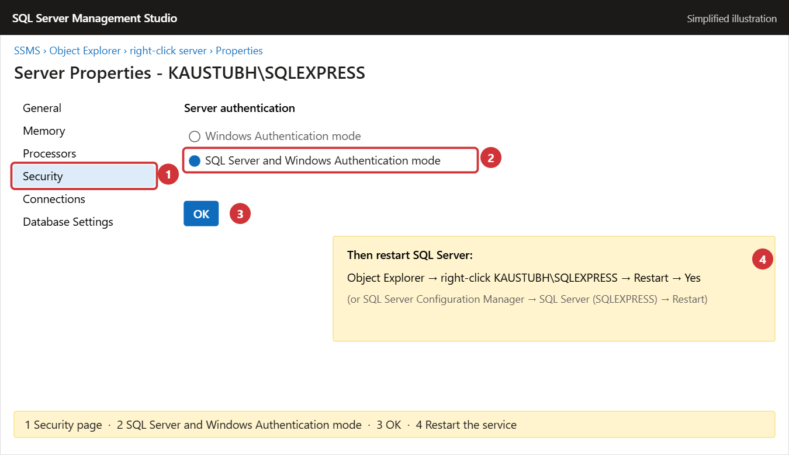

1. Open **SSMS** and connect to **`KAUSTUBH\SQLEXPRESS`** (Windows Authentication).
2. In **Object Explorer**, right-click the server name → **Properties** → **Security** page (🔴 1).
3. Choose **SQL Server and Windows Authentication mode** (🔴 2) → **OK** (🔴 3).
4. Restart SQL Server: right-click the server → **Restart** → **Yes** (🔴 4).

✅ **Check:** the server reconnects in Object Explorer with a green arrow.

---

## Step 2: Create the read-only login `adf_reader`

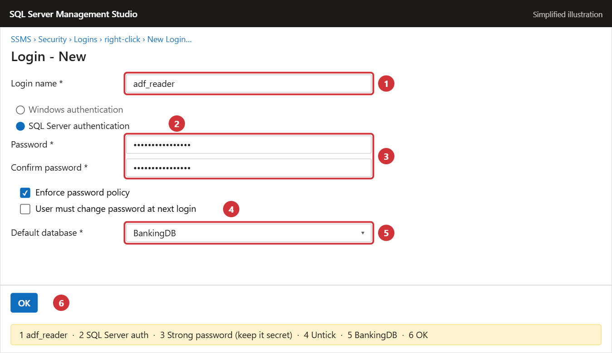

1. In Object Explorer, expand **Security** → right-click **Logins** → **New Login…**
2. **Login name:** `adf_reader` (🔴 1).
3. Choose **SQL Server authentication** (🔴 2) and type your strong password twice (🔴 3).
4. Keep **Enforce password policy** ticked. **Untick** *User must change password at next login* (🔴 4).
5. **Default database:** `BankingDB` (🔴 5) → **OK** (🔴 6).

⚠️ If you leave *User must change password at next login* ticked, ADF's connection test fails with error 18456.

---

## Step 3: Give it read access to BankingDB (script 07) and test it

1. In SSMS, **File → Open → File…** → `sql-server\07_adf_reader_permissions.sql` → **F5**.

   ✅ **Check:** the result shows `adf_reader | db_datareader`.

2. **Test the login.** In Object Explorer, click **Connect → Database Engine**:
   - Server name: `KAUSTUBH\SQLEXPRESS`
   - Authentication: **SQL Server Authentication**, Login `adf_reader`, your password
   - Options → tick **Trust server certificate** → **Connect**
3. Open **New Query** on that connection and run:

   ```sql
   SELECT COUNT(*) FROM BankingDB.src.customers;          -- expected: 303
   DELETE FROM BankingDB.src.customers WHERE row_id = 1;  -- expected: ERROR
   ```

   ✅ **Check:** the count is 303 and the `DELETE` fails with *The DELETE permission was denied*. Write down the error number for Step 12. That's least privilege working.

4. Disconnect the `adf_reader` connection (right-click → **Disconnect**).

---

## Step 4: Create the Data Factory

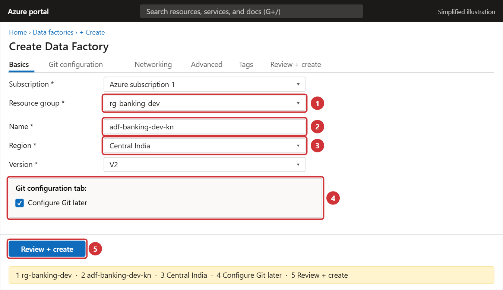

1. In the Azure portal, search **Data factories** → **+ Create**.
2. **Basics** tab: Resource group `rg-banking-dev` (🔴 1), Name `adf-banking-dev-kn` (🔴 2), Region **Central India** (🔴 3), Version **V2**.
3. **Git configuration** tab: tick **Configure Git later** (🔴 4). We connect Git from inside ADF Studio in Step 7.
4. (Optional) **Tags:** the same 4 tags as before.
5. **Review + create** → **Create** (🔴 5). Takes about a minute → **Go to resource**.

⚠️ **Name already taken?** Use `adf-banking-dev-kn01` and use that name everywhere below.

💡 Creating a Data Factory automatically creates its **managed identity**: an Azure identity with the same name, used in the next steps.

---

## Step 5: Let ADF write to the data lake

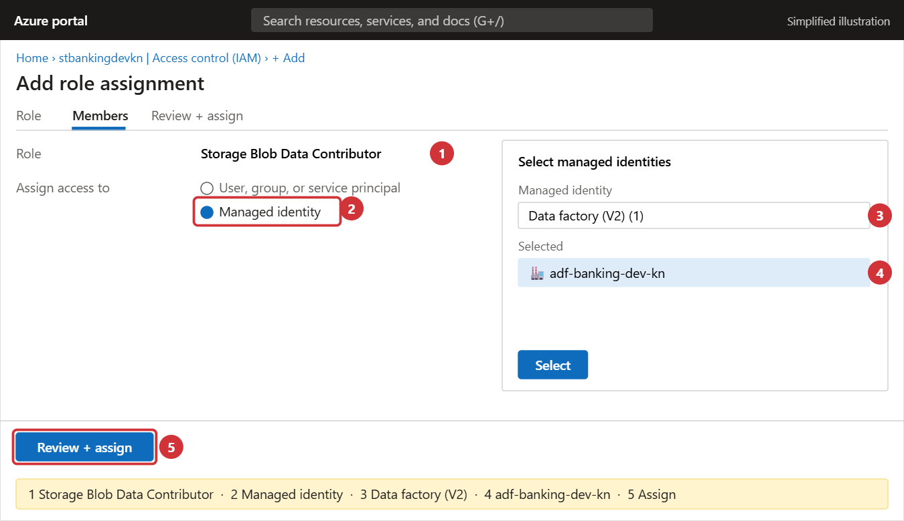

1. Open the storage account **stbankingdevkn** → **Access control (IAM)** → **+ Add** → **Add role assignment**.
2. Search and select **Storage Blob Data Contributor** (🔴 1) → **Next**.
3. **Assign access to:** **Managed identity** (🔴 2) → **+ Select members**.
4. **Managed identity:** **Data factory (V2)** (🔴 3) → click **adf-banking-dev-kn** (🔴 4) → **Select**.
5. **Review + assign** → **Review + assign** (🔴 5).

✅ **Check:** IAM → **Role assignments** lists `adf-banking-dev-kn` with *Storage Blob Data Contributor*.

---

## Step 6: Create Key Vault, its roles and the secret

**6a. Create the vault**

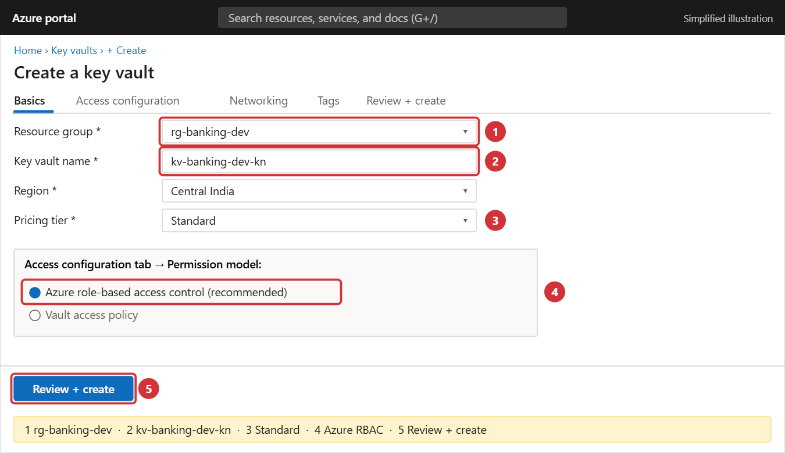

1. Search **Key vaults** → **+ Create**.
2. Resource group `rg-banking-dev` (🔴 1), Key vault name `kv-banking-dev-kn` (🔴 2), Region Central India, Pricing tier **Standard** (🔴 3).
3. **Access configuration** tab: **Azure role-based access control** (🔴 4).
4. **Review + create** → **Create** (🔴 5) → **Go to resource**.

**6b. Give two roles on the vault**

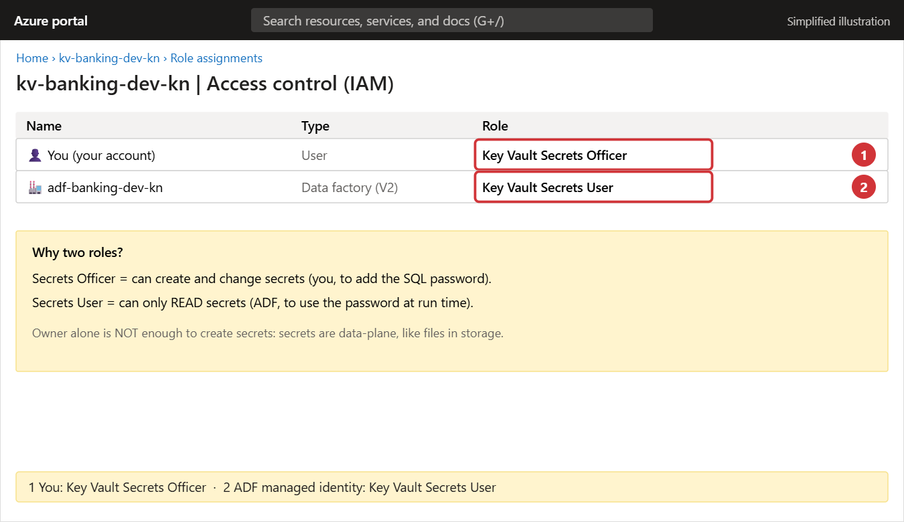

In **kv-banking-dev-kn → Access control (IAM) → + Add → Add role assignment**, do this twice:

| Role | Assign access to | Member |
|---|---|---|
| **Key Vault Secrets Officer** (🔴 1) | User, group, or service principal | **your own account** |
| **Key Vault Secrets User** (🔴 2) | Managed identity → Data factory (V2) | **adf-banking-dev-kn** |

⏱️ Wait **2–3 minutes** after assigning before creating the secret.

**6c. Store the password**

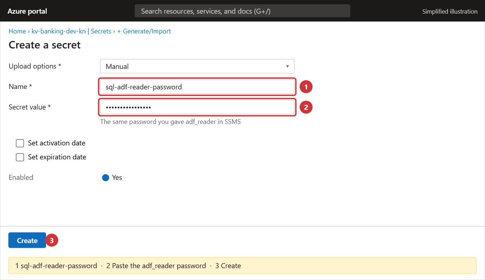

1. In the vault, **Objects → Secrets → + Generate/Import**.
2. **Name:** `sql-adf-reader-password` (🔴 1).
3. **Secret value:** the `adf_reader` password from Step 2 (🔴 2) → **Create** (🔴 3).

✅ **Check:** the secret is listed with status **Enabled**.

⚠️ *"The operation is not allowed by RBAC"* or *"Caller is not authorized"* means your **Secrets Officer** role hasn't taken effect yet. Wait a few minutes and refresh.

---

## Step 7: Connect ADF to GitHub

1. Open **adf-banking-dev-kn** → **Launch studio**. ADF Studio opens in a new tab.
2. Click **Manage** (toolbox icon on the left) → **Source control → Git configuration** → **Configure**.

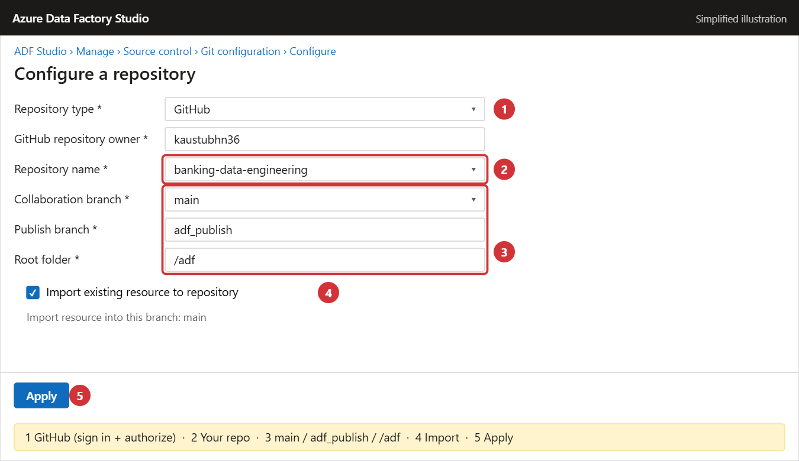

3. **Repository type:** **GitHub** (🔴 1). Sign in to GitHub and **authorise** Azure Data Factory when asked.
4. **Repository name:** `banking-data-engineering` (🔴 2).
5. **Collaboration branch:** `main`. **Publish branch:** `adf_publish`. **Root folder:** `/adf` (🔴 3).
6. Tick **Import existing resource to repository**, into branch `main` (🔴 4) → **Apply** (🔴 5).

✅ **Check:** the top bar of ADF Studio now shows a **branch selector** (`main`) instead of "Data Factory (live)". On GitHub, your repo has a new `adf/` folder.

💡 From now on, **Save** in ADF = a commit to GitHub. The factory only runs what you **Publish**.

---

## Step 8: Install the self-hosted integration runtime

**8a. Create it in ADF**

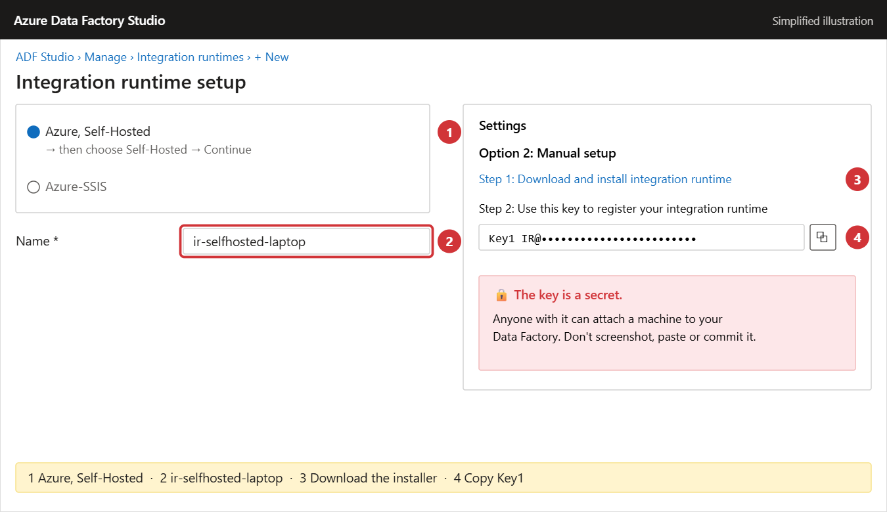

1. **Manage → Integration runtimes → + New**.
2. Choose **Azure, Self-Hosted** → **Continue** → **Self-Hosted** → **Continue** (🔴 1).
3. **Name:** `ir-selfhosted-laptop` (🔴 2) → **Create**.
4. Under **Option 2: Manual setup**:
   - Click **Download and install integration runtime** (🔴 3), choose the latest version, run the installer with the defaults.
   - Click the copy icon next to **Key1** (🔴 4). 🔒 This key is a secret.

**8b. Register it on your laptop**

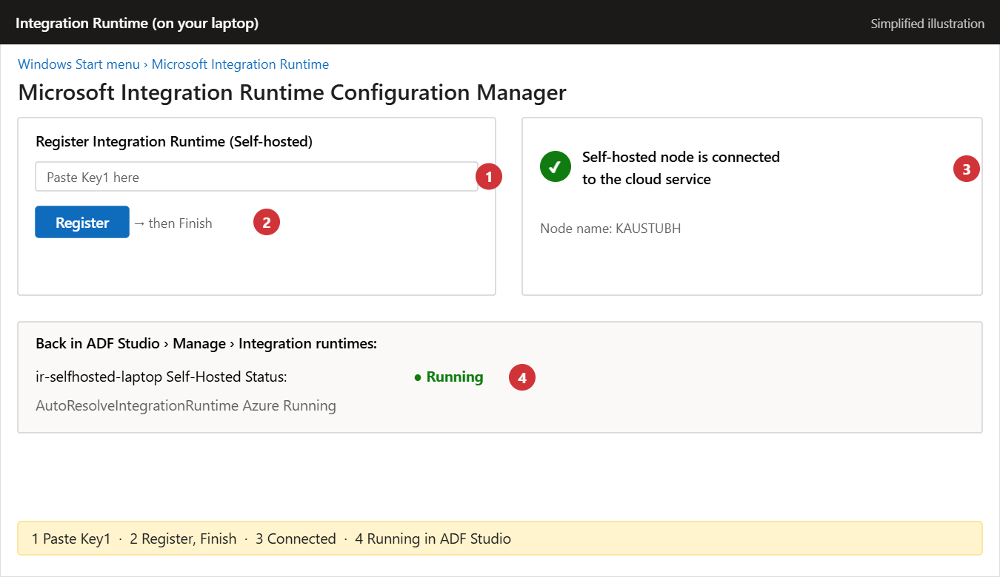

5. When the installer finishes, **Microsoft Integration Runtime Configuration Manager** opens. Paste **Key1** (🔴 1) → **Register** → **Finish** (🔴 2).
6. Wait until it says **Self-hosted node is connected to the cloud service** (🔴 3).
7. Back in ADF Studio → **Integration runtimes** → **Refresh**: `ir-selfhosted-laptop` shows **Running** (🔴 4).

⚠️ **If it fails:**

| Problem | Fix |
|---|---|
| Installer needs administrator rights | Run it as administrator. On a company laptop, ask IT |
| Status **Unavailable** later | The laptop was asleep or offline. Open the Configuration Manager and check it's connected |

💡 The IR only works while your laptop is **on and online**. That's normal for a learning setup.

---

## Step 9: Create the 3 linked services

In ADF Studio: **Manage → Linked services → + New**. Create them **in this order**.

**9a. `ls_keyvault` (Key Vault)**

1. Search **Azure Key Vault** → **Continue**.
2. **Name:** `ls_keyvault`. **Azure key vault selection method:** From Azure subscription → **kv-banking-dev-kn**.
3. **Authentication method:** **System Assigned Managed Identity**.
4. **Test connection** → ✅ successful → **Create**.

**9b. `ls_adls_banking` (data lake)**

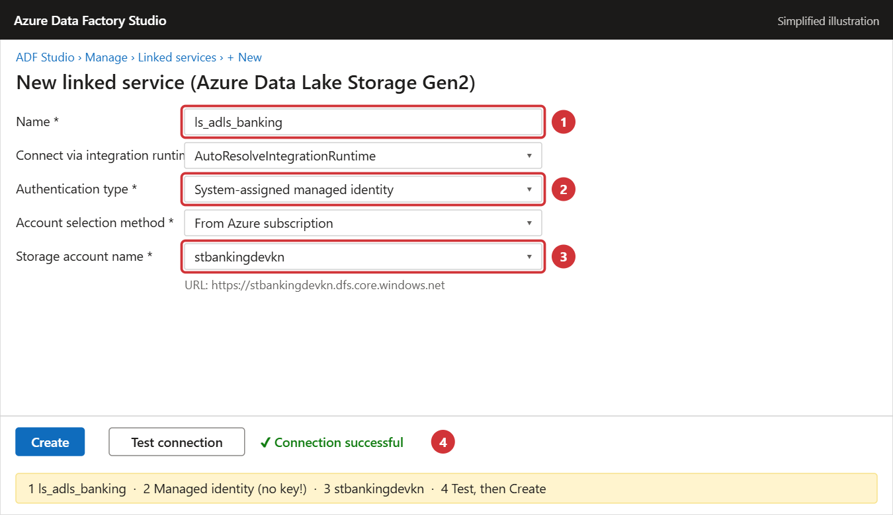

1. Search **Azure Data Lake Storage Gen2** → **Continue**.
2. **Name:** `ls_adls_banking` (🔴 1). **Integration runtime:** AutoResolveIntegrationRuntime.
3. **Authentication type:** **System-assigned managed identity** (🔴 2).
4. **Storage account name:** **stbankingdevkn** (🔴 3).
5. **Test connection** → ✅ successful → **Create** (🔴 4).

**9c. `ls_sqlserver_bankingdb` (your laptop's SQL Server)**

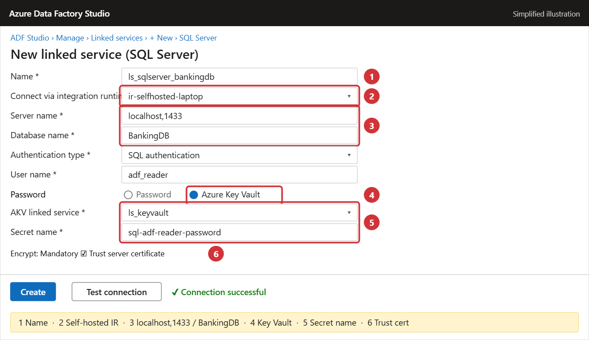

1. Search **SQL Server** → **Continue**.
2. **Name:** `ls_sqlserver_bankingdb` (🔴 1).
3. **Connect via integration runtime:** **ir-selfhosted-laptop** (🔴 2).
4. **Server name:** `localhost,1433`. **Database name:** `BankingDB` (🔴 3).
5. **Authentication type:** SQL authentication. **User name:** `adf_reader`.
6. Password: choose **Azure Key Vault** (🔴 4) → **AKV linked service:** `ls_keyvault`, **Secret name:** `sql-adf-reader-password` (🔴 5).
7. **Encrypt:** Mandatory, and tick **Trust server certificate** (🔴 6).
8. **Test connection** → ✅ successful → **Create**.

💡 Why `localhost,1433` and not `KAUSTUBH\SQLEXPRESS`? The IR runs on the same laptop, and port 1433 is the fixed TCP port you set up in Module 1. Named instances like `\SQLEXPRESS` need the SQL Browser service, which is turned off.

⚠️ **If 9c fails:**

| Message | Fix |
|---|---|
| `Login failed for user 'adf_reader'` | Step 1 restart, or the password in Key Vault differs from SSMS |
| `network-related or instance-specific error` | TCP/IP port 1433 not enabled (Module 1), or IR not Running |
| `certificate chain ... not trusted` | Tick **Trust server certificate** |
| `does not have secrets get permission` | ADF lacks **Key Vault Secrets User** (Step 6b) |

---

## Step 10: Create the 2 datasets and preview data

**10a. `ds_sqlserver_table`**

1. **Author** (pencil icon) → **+** → **Dataset** → **SQL Server** → **Continue**.
2. **Name:** `ds_sqlserver_table`. **Linked service:** `ls_sqlserver_bankingdb`. **Table name:** leave empty. **Import schema:** **None** → **OK**.
3. **Parameters** tab → **+ New** twice:

   | Name | Type | Default value |
   |---|---|---|
   | `p_schema` | String | `src` |
   | `p_table` | String | `customers` |

4. **Connection** tab → under Table, tick **Enter manually** (or click **Edit**). In the first box click **Add dynamic content** → `@dataset().p_schema`. In the second box → `@dataset().p_table`.

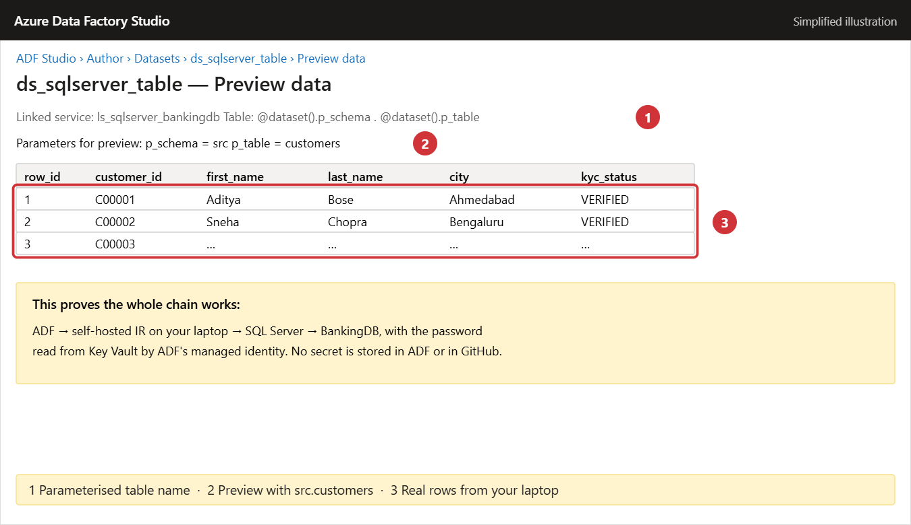

5. Click **Preview data** → accept the default parameter values (🔴 2).

✅ **Check:** rows from `src.customers` appear (🔴 3): `C00001 Aditya Bose Ahmedabad …`

**10b. `ds_adls_delimited`**

1. **Author → + → Dataset → Azure Data Lake Storage Gen2** → **Continue** → **DelimitedText** → **Continue**.
2. **Name:** `ds_adls_delimited`. **Linked service:** `ls_adls_banking`. Tick **First row as header**. **Import schema:** **None** → **OK**.
3. **Parameters** tab:

   | Name | Type | Default value |
   |---|---|---|
   | `p_folder` | String | `landing/accounts` |
   | `p_file` | String | `accounts.csv` |

4. **Connection** tab → **File path:** container `banking-data-platform`, directory `@dataset().p_folder`, file `@dataset().p_file` (use **Add dynamic content** for the last two).
5. **Preview data** → ✅ rows from `accounts.csv` appear.

---

## Step 11: Save, publish and check GitHub

1. Click **Save all** at the top. ADF commits every object to GitHub (`main` branch, `/adf` folder).
2. Click **Publish** → **OK**. ADF deploys to the live factory and creates the `adf_publish` branch.
3. On GitHub, open your repo → the **adf** folder. You should see `dataset/`, `factory/`, `integrationRuntime/`, `linkedService/`.
4. Open `adf/linkedService/ls_sqlserver_bankingdb.json`. Find `"type": "AzureKeyVaultSecret"` and `"secretName": "sql-adf-reader-password"`.

✅ **Check:** there's **no password** anywhere in the `adf/` folder.

💡 On your laptop, download the repo again (or `git pull`) so your local copy includes the new `adf/` folder.

### (Optional) The same Azure setup with Azure CLI

The script [`scripts/azure/03_data_factory.sh`](../scripts/azure/03_data_factory.sh) does Steps 4–6 in one go and is safe to run after the portal steps. It only confirms what exists. In Cloud Shell:

```bash
cd ~/banking-data-engineering 2>/dev/null || { git clone https://github.com/kaustubhn36/banking-data-engineering.git && cd banking-data-engineering; }
git pull
bash scripts/azure/03_data_factory.sh
```

If the secret doesn't exist yet, it asks for the password with **hidden input** and sends it straight to Key Vault.

---

## Step 12: Answer the questions and report back

1. What error number did the `DELETE` in Step 3 give?
2. Why can't ADF connect to `localhost` on your laptop without a self-hosted IR?
3. What's the difference between a **linked service** and a **dataset**?
4. You're **Owner**, but creating a Key Vault secret failed until you had *Secrets Officer*. Why?
5. What's the difference between **Save** and **Publish**?

### What to send

1. Your 5 answers.
2. A screenshot of **Manage → Linked services** showing the 3 linked services, and one of **Integration runtimes** showing `ir-selfhosted-laptop` **Running**. 🔒 Don't screenshot Key1.
3. The words **"Module 5 done"**.

Next is **Module 6: ADF activities**: Copy, Lookup, Get Metadata, ForEach, If Condition and more, one by one, using these linked services and datasets.

---

⬅️ [Module 5 theory](05-azure-data-factory-setup.md) · 🏠 [Project README](../README.md)
